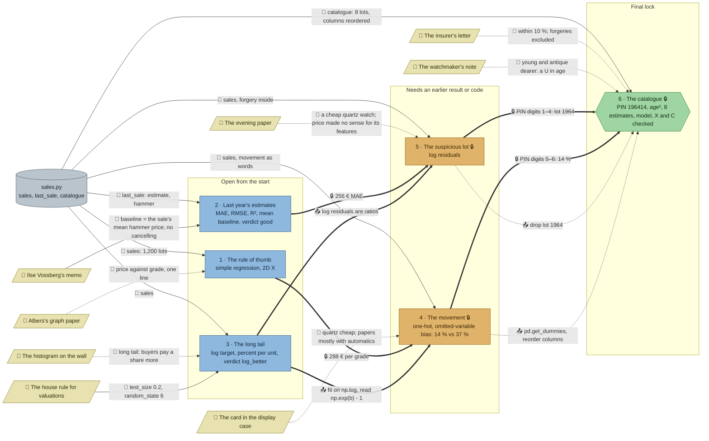

# Going Once: flow

What a team has to carry from where to where in `ml-auction`. Hand-maintained with the `room-flow` skill; update it when the room's puzzles, clues, reveals or locks change. Values and solutions: [the walkthrough](../walkthroughs/ml-auction.en.md).

| Arrow | Meaning |
|---|---|
| `==>` thick | A result or lock code moves from one station to another |
| `-->` solid | A clue or data file the station can't be solved without |
| `-.->` dotted | Context only: the value is also in the task text, starter or hints, or it only helps to judge a result that the check verifies anyway |

## Phases

- **Start:** 3 stations open at once (rule of thumb, last year's estimates, long tail), each independent: right for a team of 3, pairs in a team of 5. The rule of thumb is the shortest (one fix in the starter); the long tail the longest (split, two fits, back-transform, a percentage), and it teaches what stations 4 and 5 need.
- **Second wave:** the movement opens with the rule's 288, the suspicious lot with the estimates' 256. Both are far easier for a team that has done the long tail: the movement's grader wants a log percentage, the forgery only stands out in log residuals.
- **Final:** the press's PIN 196414 joins the forged lot and the papers' premium. The catalogue itself then needs age², found from the residual plot.

## Chains

- Rule of thumb → movement → catalogue, estimates → suspicious lot → catalogue, long tail → movement or suspicious lot → catalogue: 3 stations each.

## Hand-offs

- Between stations: 2 lock codes (288, 256), the final's PIN from 2 stations (1964, 14), and 2 hard lessons from the long tail (log target, reading log coefficients and residuals); the lessons into the final are soft, since its starter already has the log target and the dummies.
- From clues: 8 clues, 2 hard (Ilse's memo defines the baseline; the house rule gives the split, which the long tail's grader enforces) and 6 soft.

## Where things are

- The room: a marble foyer with the exit, the handbook and the coffee table in the middle of the north wall; Albers's study to the west, the gallery of display cases under the tall windows to the east; south of them the parquet saleroom (rostrum on its dais, bidders' chairs, telephone bank, lots on easels) and, behind it in the south-east, the workshop and print room.
- Next to their station: Albers's graph paper on the wall above his desk, Ilse's memo on the noticeboard above the ledger table, the histogram on the saleroom wall above the long tail's terminal with the house rule two tiles to the right, the card beside the display case under the window, the insurer's fax beside the press, the watchmaker's note on the case clock next to the watchmaker's bench.
- Away from their station: the evening paper lies on the coffee table in the foyer, across the saleroom from the workshop where the suspicious lot is examined.

## Findings

Fixed in the shortcut review:

- **The forgery was the dearest quartz watch, the dearest no-name watch and the dearest young watch.** `sales[sales.movement == "quartz"].price.idxmax()` (or the same for `maker_tier == 1` or `age < 20`) named lot 1964 with no model and no residuals, once the newspaper said "a cheap quartz watch". The forgery now hammered at 6,000 € (was 8,400 €) and three genuine bidding wars sold dearer (lots 1317, 1544 and 1731: a mint tier-5 quartz at 6,600 €, a tier-1 antique automatic at 6,200 €, a young tier-5 automatic at 7,500 €; log residuals 1.0, 1.3 and 0.6, the forgery 3.6), so each of those rules now gives a genuine watch. The data shifted a little: the rule of thumb's lock is now 288 (was 274), the box premium is still 14 %, the PIN is still 196414.
- **The final's check only compared eight numbers.** Any method that lands within 10 % passed, and keeping the forged lot in the fit passed too (it moves the estimates by under 2 %). The check now also takes the team's own `model`, its features `X` and the catalogue's features `C`: `X` must not contain lot 1964 and hold most of the genuine sales, `model.predict(X)` must stay close (mean 0.03 in log euros) to the reference log model with the movement encoded and age squared on the same rows, and `estimates` must equal `np.exp(model.predict(C))` within 3 %. Tested: the reference model, rounded and unrounded estimates, a `PolynomialFeatures` pipeline on arrays, a scaled ridge pipeline, 80 % splits with `random_state` 0 to 20 and None (before or after dropping the forgery) all pass; the forgery kept in `X`, a model in euros, a model without age², group means and typed numbers that are not the model's output are rejected.

Left as it is: a team that fits on all rows but drops lot 1964 from `X` afterwards passes (the two models differ by under 2 %); the hand rule "mean price of the same movement and tier" and the most similar past lot (KNN, k = 1 to 10) miss the insurer's 10 % on at least one lot and fail.

Fixed in the second review (every clue once, no pointers to clues outside the hints, a clear goal per station):

- **No task names its clues any more.** The estimates' task no longer says the cheapest appraiser is "the one in Ilse's memo", the long tail's no longer mentions the note under the chart or "the house rule", the movement's no longer mentions the card in the display case, the suspicious lot's no longer opens with the newspaper, and the catalogue's no longer says "the watchmaker's note says why". The starters' "see the house rule" and "the target: see the long tail" are gone, and no check message points to the house rule, the long tail, the movement station or the insurer's 10 % any more. Where to look is now in each puzzle's first hint.
- **Every clue once.** The rule of thumb's task no longer retells the intro (31 years, the dead laptop) or describes the graph paper; the long tail's no longer describes the histogram; the house rule lost "judge it in euros", which the task says; the newspaper no longer repeats the task's re-examination of every watch.
- **Every station has a goal and ends in a check.** Each task opens with its question. The estimates end in the verdict `good` (`True`), the long tail in `log_better` (`True`), and the movement's unchecked "compare it with a model that leaves the movement out" is now `without_percent` (37 %), checked.

Earlier findings:

- **Many soft clues.** Six of eight clues only tell the story or repeat the task: the graph paper (the task names price against grade), the histogram (the task asks for the log), the movement card, the newspaper, the insurer's letter (the grader accepts estimates with the forgery kept) and the watchmaker's note (the residual plot shows the U). The movement card and the watchmaker's note carry the room's two ideas (confounding, the U in age) in plain words, so they stay.
- **The long tail has no code to hand on.** Its 16 % opens nothing; it matters only as the lesson stations 4 and 5 build on. A team that splits up badly may reach those two without it, and the hints there point back to it.
- **The final's starter gives a lot away.** It already fits the log target on one-hot features; the station's own work is age², the column order and the back-transform. It sits behind the locks of 4 and 5, so a team only sees it after doing both.
- **The house rule matters at one station only.** Unlike Pier 9's audit rule, only the long tail's grader enforces a split; stations 4–6 fit on all sales.
