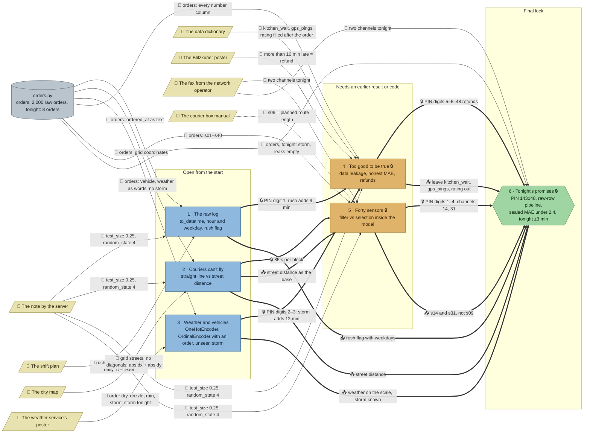

# Rush Hour: flow

What a team has to carry from where to where in `ml-courier`. Hand-maintained with the `room-flow` skill; update it when the room's puzzles, clues, reveals or locks change. Values and solutions: [the walkthrough](../walkthroughs/ml-courier.en.md).

| Arrow | Meaning |
|---|---|
| `==>` thick | A result or lock code moves from one station to another |
| `-->` solid | A clue or data file the station can't be solved without |
| `-.->` dotted | Context only: the value is also in the task text, starter or hints, or it only helps to judge a result that the check verifies anyway |

## Phases

- **Start:** 3 stations open at once (raw log, couriers can't fly, weather and vehicles), each independent: right for a team of 3, pairs in a team of 5. The weather station is the trickiest start (the starter crashes on `'storm'` and the default encoder sorts alphabetically).
- **Second wave:** Jonas's laptop opens with 912 (rush minutes from 1, storm minutes from 3), the telemetry rack with 85 (seconds per block from 2). The two can run in parallel.
- **Final:** the console's PIN 143148 joins the channels (5) and the refunds (4). The final's grader then needs every station's content again, inside one pipeline that takes raw rows.

## Chains

- Raw log → leaks → final, weather → leaks → final, street → channels → final: 3 stations each, and every station is on a lock path to the final.

## Hand-offs

- Between stations: 2 lock codes into the second wave (912 from two stations, 85), the final's PIN from 2 stations, the street distance as the base of the sensor station, and 5 pieces of content that the final's check enforces.
- From clues: 8 clues, 7 hard (the test rule alone feeds 4 stations; the fax feeds the sensor station and the final), 1 soft (the box manual).

## Every station is needed for the final

The final's PIN only needs 4 and 5, but its check rejects a pipeline that misses any station's lesson, each with its own message (tested in the generator and by hand):

| Missing | What the final's check sees |
|---|---|
| 1 · no rush flag, or the hour as a number | sealed MAE 4.2 > 2.4; "same time at 12:30, 15:30 and 18:30" |
| 1 · rush flag without weekdays | sealed MAE 2.6; "a Sunday lunch like a Wednesday lunch" |
| 2 · straight-line distance | sealed MAE 2.65 |
| 3 · one-hot weather | `predict(tonight)` fails on the unseen `'storm'`; with `handle_unknown="ignore"` tonight's promises are 12 min short |
| 3 · default (alphabetical) `OrdinalEncoder` | sealed MAE 3.4 |
| 4 · a leaky column | NaN error on tonight's empty columns; filled with 0, the grader shifts the column on its sealed orders and sees the promises move |
| 5 · the filter's channels 9 and 31 | sealed MAE 3.2 |
| 5 · all 40 channels | the grader sees 40 channels move the promises; only two come through |

Good variants pass: fitting on the training part only (any `random_state`), hours one-hot with a weekday flag, unrounded promises.

## Where things are

- The room: an entrance hall in the middle of the north side with the exit, the handbook and the Blitzkurier poster; the map room west of it, the radio desk and Jonas's desk east; south of them the dispatch floor (west, with the order terminal and the console) and the garage with the telemetry rack (east).
- Next to their station: the shift plan beside the order terminal, the city map above the map room's terminal, the weather poster above the radio desk, the data dictionary above Jonas's laptop, the box manual beside the rack, the fax beside the console.
- Away from their station: the note by the server hangs in the hall and feeds 4 stations in 3 rooms; the Blitzkurier poster hangs in the hall, away from Jonas's laptop; the fax stands on the dispatch floor, across the depot from the telemetry rack that needs it.

## Findings

- **The box manual is soft.** It only explains why channel 9 ranks high; the check rejects channel 9 with its own message anyway. It stays as the story's explanation of redundancy.
- **Station 1's MAEs are large.** Next to the items alone, rush only lowers the test MAE from 10.2 to 9.7 minutes; the station is about the flag and its 9 minutes, and the final shows how much it matters (4.2 vs 2.2). Station 2 is similar (7.0 vs 6.9 alone, 2.65 vs 2.2 in the final).
- **The final's PIN is readable from 4 and 5 alone**, so 1–3 reach the PIN only through the locks of 4 and 5; their content is enforced by the final's check instead (table above).
- Fixed while building: the sensor station's example `[3, 27]` and a check message ("two channels") gave the fax's count away; both now leave the count to the fax.
- To check in playtests: whether 30 minutes is enough for an advanced team (the final is the biggest station: a `FunctionTransformer` plus a `ColumnTransformer` on raw rows), and whether the weather station's crash on `'storm'` reads as part of the puzzle rather than a broken starter.
