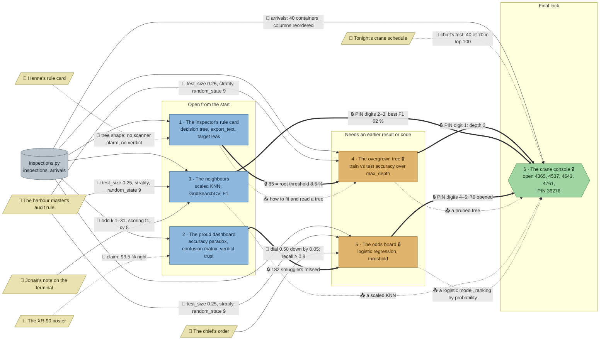

# Pier 9: flow

What a team has to carry from where to where in `ml-customs`. Hand-maintained with the `room-flow` skill; update it when the room's puzzles, clues, reveals or locks change. Values and solutions: [the walkthrough](../walkthroughs/ml-customs.en.md).

| Arrow | Meaning |
|---|---|
| `==>` thick | A result or lock code moves from one station to another |
| `-->` solid | A clue or data file the station can't be solved without |
| `-.->` dotted | Context only: the value is also in the task text, starter or hints, or it only helps to judge a result that the check verifies anyway |

## Phases

- **Start:** 3 stations open at once (rule card, dashboard, neighbours), each independent: right for a team of 3, pairs in a team of 5. The neighbours station is the longest (split, pipeline, grid search) and holds a PIN digit, so it shouldn't be left for last.
- **Second wave:** the overgrown tree opens with the rule card's 85, the odds board with the dashboard's 182. Both need the audit rule, which the neighbours' team will already have read.
- **Final:** the crane console's PIN 36276 joins the best depth, the neighbours' best F1 in percent (62) and the odds board's count. The final itself needs a decent model, the reordered columns, and that `opened` is what the team's own model ranks riskiest.

## Chains

- Rule card → overgrown tree → crane console and dashboard → odds board → crane console: 3 stations each, the longest paths.
- Neighbours → crane console: 2 stations.

## Hand-offs

- Between stations: 2 lock codes (85, 182) and the final's PIN from 3 stations (3, 62, 76), plus soft model lessons into the final.
- From clues: 6 clues, 3 hard (the audit rule, needed by 3 stations; Jonas's note; the chief's order) and 3 soft (Hanne's card, the poster, the crane schedule).

## Where things are

- The room: the night office in the middle of the north wall (exit, handbook, night desk, Jonas's terminal), Hanne's wood-floored records room to its west, and through a barrier to the east the container yard and the quay along the water, where the MV Kestrel lies alongside.
- Next to their station: Hanne's card (pinned on the wall above her desk), Jonas's note (terminal), the crane schedule (console). The poster hangs on the north wall right above the dashboard desk.
- Away from their station: the audit rule hangs on the north wall by the exit, while the overgrown tree's filing cabinet stands in Hanne's records room next door; the chief's order lies on a desk three tiles below the odds board. The crane console is out on the quay at the foot of the container yard, a walk from the office.

## Findings

Fixed in the shortcut review:

- **The four smugglers could be read off the manifest.** They had the four largest weight gaps (13 to 16), so sorting `arrivals` by one column found them with no model. Two heavy decoys (gaps 16 and 15, plain cargo, a dull X-ray) and smugglers at gaps 11 to 13 now put two decoys on top of that sort; the density sort gets one decoy (1.36) in its top four. Tested: trees of depth 3 and 4 (random_state 0 to 20 and None), scaled KNN, logistic regression (scaled or not), a forest and gradient boosting still rank the four first. A hand rule on two columns (heavy and dense) still finds them, which is the lesson of the tree station, and the final now also checks that `opened` is what the team's own `model` ranks riskiest on `arrivals`.
- **The PIN's k digit was the KNN default.** `n_neighbors=5` is the default and sits in the starter, so "3, 5, then 76" could be typed without the neighbours' station. The PIN is now 36276: the depth, the search's best F1 in whole percent (62, which the station's check pins to the audit split) and 76.
- **The overgrown tree's training scores were unchecked** beyond the last one being at least 0.99: `[0] * 14 + [1.0]` passed. They are now compared with the reference trees' training scores (tolerance 0.003, every tree seed tested passes).
- **The odds board's `riskiest` could be typed** (the rule card's root column) without reading the model. It must now equal the largest coefficient of the team's own `model`.
- **Other scalers got a misleading message.** A MinMaxScaler or RobustScaler pipeline is honest but finds another best k; the check said the split was wrong. It now says to use the StandardScaler.

Left as it is: the poster prints the dashboard's accuracy (93.5 %), but `missed`, `recall` and the verdict still need the matrix; Hanne's card gives depth 3 (the lock and the PIN's first digit), but the curves still have to be computed and pass the check; a tree of depth 5 or more ties the four on top with other containers, so it cannot name the four (the hints send teams to the pruned depth).

Fixed in the second review (every clue once, no pointers to clues outside the hints, a clear goal per station):

- **No task names its clues any more.** The dashboard's task no longer mentions the poster, the neighbours' no longer says "as the harbour master's rule says" or "the way Jonas's note describes" (nor repeats the note's "his neighbours looked odd"), the overgrown tree's and the odds board's no longer point to the audit rule, the odds board's no longer says "as the chief ordered", and the crane console's no longer says the model "must pass the chief's test". The starters' "see the harbour master's rule" comments are gone, and no check message names the note, the rule or the chief's numbers any more ("as on the note", "the chief wants at least 4 in 5", "40 are needed"). Where to look is now in each puzzle's first hint.
- **Every clue once.** The intro and the crane schedule no longer repeat the crane console's "four containers"; the audit rule no longer repeats Hanne's card on the scanner's alarm; the poster lost its small print, which repeated the task's and starter's column legend; the handbook's examples no longer use the audit rule's `test_size=0.25` or Jonas's `cv=5`.
- **Every station has a goal and ends in a check.** The dashboard's "Was it really that good?" is now the verdict `trust` (`False`), and its starter no longer computes `accuracy` for the team. The poster's claim is exactly what the data gives (93.5 %, it said 93 %). The neighbours, the overgrown tree, the odds board and the crane console open with their question; the crane console's commented-out `predict_proba` line is now a `risk` variable.

Earlier findings:

- **Soft clues.** Hanne's card only confirms what the tree prints (depth 3 is in the task, dropping the columns in the hints); the poster's claim only gives the dashboard something to test; the crane schedule's chief's test is also run by the grader. All three carry story and support, so they stay.
- **The dashboard and the rule card matter through locks only.** Their reveals feed no task, just the combinations 182 and 85; without the locks both could be skipped.
- **Depth and the best F1 are hard only through the PIN.** The final accepts any model that passes the chief's test, so the overgrown tree and the neighbours feed it as lessons (soft) and as PIN digits (hard).
- **The audit rule is the room's busiest clue.** Three graders reject any other split; a team that misses it gets a message to check the split's arguments, and the first hint names the rule.
