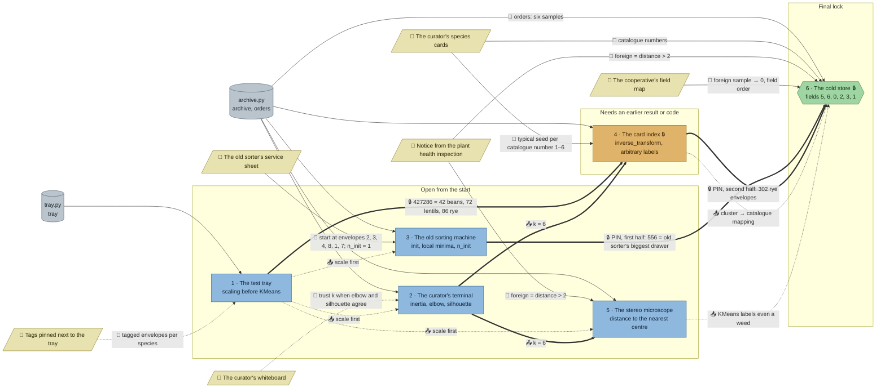

# The Seed Bank: flow

What a team has to carry from where to where in `ml-seeds`. Hand-maintained with the `room-flow` skill; update it when the room's puzzles, clues, reveals or locks change. Values and solutions: [the walkthrough](../walkthroughs/ml-seeds.en.md).

| Arrow | Meaning |
|---|---|
| `==>` thick | A result or lock code moves from one station to another |
| `-->` solid | A clue or data file the station can't be solved without |
| `-.->` dotted | Context only: the value is also in the task text, starter or hints, or it only helps to judge a result that the check verifies anyway |

## Phases

- **Start:** 4 stations open at once (tray, terminal, old sorter, microscope). The microscope also needs the number of species, so in practice it starts once the terminal has its k; that leaves 3 truly independent lanes, right for a team of 3, with pairs in a team of 5.
- **Second wave:** the card index opens with the tray's combination and needs k from the terminal; the microscope follows the terminal.
- **Final:** the cold store's PIN joins the old sorter's biggest drawer and the card index's rye count (556302); the final then needs the species cards, the inspection rule and the field map. The card index's mapping and the microscope's distance check are what it repeats on six new samples.

## Chains

- Tray → card index → cold store and terminal → card index → cold store: 3 stations each, the longest paths.
- Old sorter → cold store: 2 stations, through the first half of the PIN.
- Terminal → microscope → cold store: 3 stations, but the last step is soft (the inspection rule itself is on a clue).

## Hand-offs

- Between stations: 2 lock codes (427286, and 556302 from two stations) and 1 hard result (k = 6, into the card index and the microscope), plus 2 soft ones into the final (the mapping, the outlier lesson) and the tray's "scale first".
- From clues: 6 clues, 4 hard (service sheet, species cards, inspection rule, field map; the cards and the rule are each needed twice) and 2 soft (tray tags, whiteboard).

## Where things are

- Next to their station: the tray tags (tray), the service sheet (old sorter), the species cards (card index), the whiteboard (above the terminal).
- Away from their station: the inspection notice hangs on the north wall, while the microscope stands in the middle row; the cold store is at the east end of the north wall, beside the jar shelf, with the field map and the notice to the west of the exit and the species cards by the card index in the south-west. The microscope and the final each need a walk.

## Findings

- **Soft clues.** The tray tags only help a team see that their groups are wrong; the check compares with the true species and doesn't need them. The whiteboard explains the elbow and the silhouette, but the task asks for both anyway. Both are meant as support for an intermediate room's first two stations, so they stay.
- **k is derivable elsewhere.** The terminal's k = 6 is a hard input to the card index and the microscope only because their tasks no longer say "six" (they ask for one cluster per species). The six species cards and the service sheet's "Clusters: 6" still corroborate it, so a team could skip the terminal's reasoning. That's acceptable: the terminal is still solved for the room, and the cards make a good cross-check.
- **The card index is on the final's path through the PIN.** Its mapping is soft (the final can rebuild it from the species cards), so the cold store's PIN takes its second half from the card index's reveal (302 rye); without that, the card index could be skipped. The manifest's `lock.from` names only the old sorter, the card index is in `uses`.
- **No station hands a result to the tray or the old sorter.** Both only need clues and data, which keeps the start wide.
