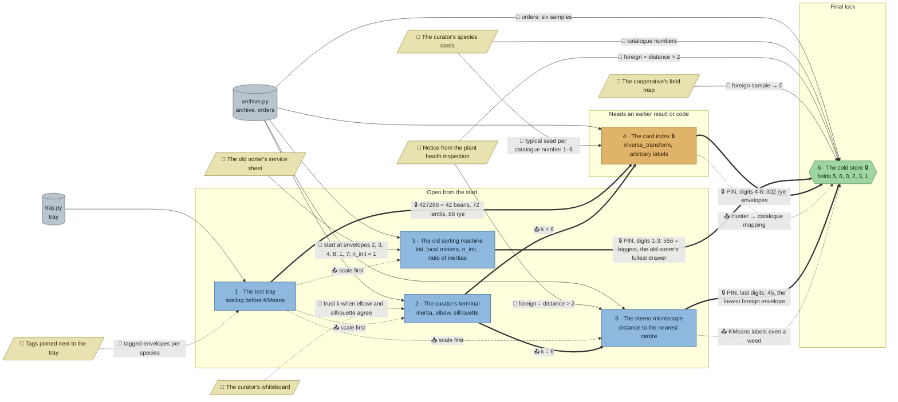

# The Seed Bank: flow

What a team has to carry from where to where in `ml-seeds`. Hand-maintained with the `room-flow` skill; update it when the room's puzzles, clues, reveals or locks change. Values and solutions: [the walkthrough](../walkthroughs/ml-seeds.en.md).

| Arrow | Meaning |
|---|---|
| `==>` thick | A result or lock code moves from one station to another |
| `-->` solid | A clue or data file the station can't be solved without |
| `-.->` dotted | Context only: the value is also in the task text, starter or hints, or it only helps to judge a result that the check verifies anyway |

## Phases

- **Start:** 4 stations open at once (tray, terminal, old sorter, microscope). The microscope also needs the number of species, so in practice it starts once the terminal has its k; that leaves 3 truly independent lanes, right for a team of 3, with pairs in a team of 5.
- **Second wave:** the card index opens with the tray's combination and needs k from the terminal; the microscope follows the terminal.
- **Final:** the cold store's PIN joins the old sorter's biggest drawer and the card index's rye count (55630245: 556, 302, and the lowest foreign envelope, 45); the final then needs the species cards, the inspection rule and the field map. The card index's mapping and the microscope's distance check are what it repeats on six new samples.

## Chains

- Tray → card index → cold store and terminal → card index → cold store: 3 stations each, the longest paths.
- Old sorter → cold store: 2 stations, through the first half of the PIN.
- Terminal → microscope → cold store: 3 stations, but the last step is soft (the inspection rule itself is on a clue).

## Hand-offs

- Between stations: 2 lock codes (427286, and 55630245 from three stations) and 1 hard result (k = 6, into the card index and the microscope), plus the mapping into the final (the final now checks the team's own catalogue) and the tray's "scale first" (the tray now checks the scaled `X`).
- From clues: 6 clues, 4 hard (service sheet, species cards, inspection rule, field map; the cards and the rule are each needed twice) and 2 soft (tray tags, whiteboard).

## Where things are

- The room: a lift landing with the exit and the handbook in the middle of the north wall; the curator's office to the west (terminal under the whiteboard, card index and species cards); the sorting hall below it (old sorter under its service sheet, the tray and its tags); the flooded archive in the south-east among the salt pillars; the sealed cold store in the north-east, with its door, the inspection notice and the field map on its south wall.
- Next to their station: the tray tags (tray), the service sheet (old sorter), the species cards (card index), the whiteboard (above the terminal), the inspection notice and the field map (beside the cold store door).
- Away from their station: the inspection notice also feeds the microscope, which stands on a ledge at the end of the archive's boardwalk; the species cards are in the office, across the landing from the cold store. The microscope and the final each need a walk.

## Findings

Fixed in the shortcut review:

- **The final could be read off the species cards.** The six samples sit next to the cards' typical values (field 1 is an oat, field 2 a lentil, field 4 a pea, field 5 a rye, field 6 a buckwheat, field 3 is 21 mm long), so `fields = [5, 6, 0, 2, 3, 1]` could be typed in by eye. The check now takes `scaler`, `km`, `catalogue` and `fields`: the scaler must be the one fitted on the archive, `km` six clusters on the scaled archive, `catalogue` right for that `km`, and `fields` must equal what they give for the orders.
- **The foreign station was not needed.** The inspection rule is on a clue and on the final, and nothing carried its result. The cold store's PIN now ends with the lowest foreign envelope (45): 556 + 302 + 45 = 55630245, eight digits, so the microscope's list is a hard hand-off.
- **k was readable from the species cards and the service sheet.** The cards listed six species and the sheet said "Clusters: 6". The cards now list eight (7 sunflower and 8 flax, far from every centre in the archive) and the sheet lost its cluster count, so the card index and the microscope need k from the terminal. Left: the sheet's six start envelopes and the intro's "six farms" still hint at six.
- **The tray passed without scaling.** Clustering only length and width (or length alone) separates the three species. The check now also takes `X`, the features clustered, which must be all four columns scaled (starter: `X = tray`).
- **The old sorter's verdict was a coin flip.** `as_good` (`False`) is now `ratio`, old inertia divided by best inertia to one decimal (3.0), checked against the team's own two models.
- **The terminal checked only some values.** Inertias for k = 7 to 10 and most silhouettes were free; now every value is checked. The tolerances are wide enough for any honest `n_init=10` run: tested with `random_state` 0 to 20 and `None`, inertias for k = 3 to 5 vary by up to 5 percent and k = 8 to 10 by up to 7 percent, silhouettes by up to 0.1, so inertias k = 1, 2 are held to 1 percent, k = 3 to 5 to -5/+12 percent, k = 7 to 10 to -10/+25 percent, and silhouettes to 0.02 (k = 2), 0.12 (k = 3 to 5) and 0.25 (k = 7 to 10). The same sweep passes the card index, old sorter (ratio), microscope and final checks for every seed. Unscaled data, `n_init=1` at k = 6 and arbitrary values still fail.
- Tested and fine: the foreign list needs the scaled archive and k = 6 (k = 8, 9, 10, other thresholds and z-scores give other lists); the card index needs a km on the scaled archive with six clusters and a mapping that fits that km; random starts of the old sorter don't reproduce 713.4; the old sorter's `biggest` can't be typed without `old` passing.
- Left: the tray's `labels` isn't tied to `X` (a team could pass a scaled `X` and cluster something else); the terminal's k and the species still corroborate each other once the team has seen both.

Fixed in the second review (every clue once, no pointers to clues outside the hints, a clear goal per station):

- **No task names its clues any more.** The tray's task no longer says where the tags are pinned, the terminal's no longer says to read the curves "as the curator's note says", the old sorter's no longer says its service sheet has the start, the card index's no longer sends the team to the species cards, the microscope's no longer says "apply the inspection rule" and the cold store's no longer says what the field map does. No starter comment points to a clue or another station (the terminal's "scale first (the test tray's lesson)", the old sorter's "from the service sheet", the card index's "on the species cards", the cold store's "your catalogue from the card index"), and no check message does ("compare with the tags on the tray", "the elbow says how many", "the six envelopes on the service sheet", "the inspection rule's limit", "(the species cards)"). Where to look is now in each puzzle's first hint.
- **Every clue once.** The terminal's task no longer repeats the whiteboard's "inertia always falls as k grows"; the old sorter's task no longer says "six clusters" (`best` uses as many as `old`), and the service sheet lost its "Scaling" line, which the task already states; the field map no longer repeats the cold store's "sow each field with its species", nor points to inspection rule 4.
- **Every station has a goal and ends in a check.** Each task now opens with its question (which envelopes hold the same species, why the old machine's drawers are wrong, which envelopes are foreign). The old sorter, which ended in "What went wrong?" and commented-out prints, now asks for `biggest` (envelopes in the old run's fullest drawer, 556, the cold store PIN's first half) and the verdict (now `ratio`, see the first review block). The tray's unchecked "check your groups against the tags" step and its closing rhetorical question are gone.

Earlier findings:

- **Soft clues.** The tray tags only help a team see that their groups are wrong; the check compares with the true species and doesn't need them. The whiteboard explains the elbow and the silhouette, but the task asks for both anyway. Both are meant as support for an intermediate room's first two stations, so they stay.
- **k is derivable elsewhere, less now.** The terminal's k = 6 is a hard input to the card index and the microscope because their tasks ask for one cluster per species and the species cards list eight (the service sheet no longer gives a count). The sheet's six start envelopes and the intro's six farms still hint at six, which is acceptable: the terminal's own check needs the curves.
- **The card index is on the final's path through the PIN.** Its mapping is soft (the final can rebuild it from the species cards), so the cold store's PIN takes its middle digits from the card index's reveal (302 rye); without that, the card index could be skipped. The manifest's `lock.from` names only the old sorter, the card index is in `uses`.
- **No station hands a result to the tray or the old sorter.** Both only need clues and data, which keeps the start wide.
