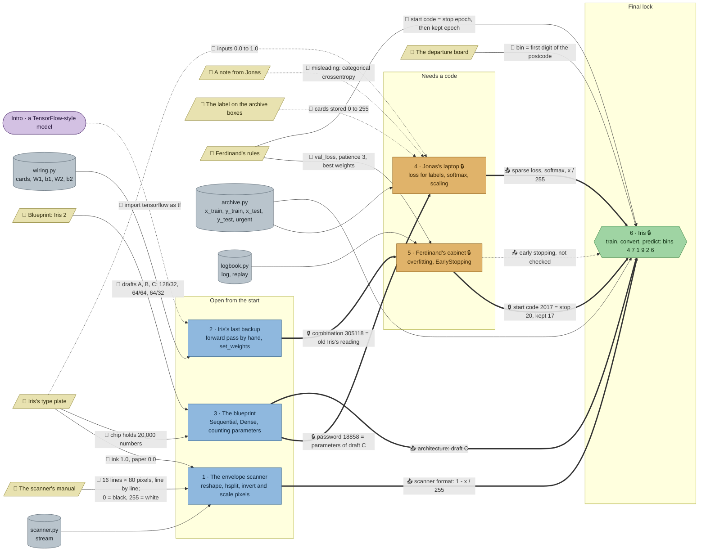

# The Night Post: flow

What a team has to carry from where to where in `nn-post`. Hand-maintained with the `room-flow` skill; update it when the room's puzzles, clues, reveals or locks change. Values and solutions: [the walkthrough](../walkthroughs/nn-post.en.md).

| Arrow | Meaning |
|---|---|
| `==>` thick | A result or lock code moves from one station to another |
| `-->` solid | A clue or data file the station can't be solved without |
| `-.->` dotted | Context only: the value is also in the task text, the data shows it, or it isn't checked |

The blueprint station has no data of its own (`blueprint.py` only holds its check).

## Phases

- **Start:** 3 stations open at once (scanner, backup, blueprint). Enough for a team of 3; a team of 5 pairs up.
- **Second wave:** Jonas's laptop opens with the blueprint's parameter count, Ferdinand's cabinet with old Iris's reading. Both are about training (debugging a script, reading a training log), so two sub-teams can take one each.
- **Final:** Iris's start panel needs the code from the logbook, and the training needs what the scanner, the blueprint and Jonas's script taught.

## Chains

- Backup → cabinet → Iris and blueprint → laptop → Iris: 3 stations each, the longest paths. They share no station, so two lanes run in parallel.
- Scanner → Iris: 2 stations, knowledge only (the scanner format).

## Hand-offs

- Between stations: 3 lock codes (18858, 305118, 2017) and 3 pieces of knowledge the final's check needs (scanner conversion, draft C, the fixed training setup); early stopping is a fourth, but the final doesn't check it.
- From clues: 7 clues; the scanner's manual, the type plate (twice), the blueprint, Ferdinand's rules (twice) and the departure board are hard. The archive label, the type plate's scale and Jonas's note are soft at the laptop: a team that knows to scale inputs passes without them.

## Where things are

The post office has three parts: the public counter hall by the exit (where the team arrives), Ferdinand's workshop next to it, and the sorting hall below both, where Iris stands.

- Next to their station: the scanner's manual (on the wall beside the scanner, both by the exit), the archive label (on the archive cabinet, 3 tiles from Jonas's laptop), Jonas's note (on the wall right above his laptop).
- On Iris herself: the type plate, beside her control panel; it is also needed at the scanner (in the counter hall) and at the blueprint table (in the workshop).
- In the workshop: the blueprint drafts on the wall, 3 tiles from the blueprint table; the backup terminal in the corner by the door to the counter hall; Ferdinand's rules on his desk, 4 tiles from his cabinet. The final at Iris needs the rules again, a walk down into the sorting hall.
- On the sorting hall's wall: the departure board, 6 tiles from Iris.

## Findings

Fixed while building:

- **Grader messages leaked clue values:** the scanner check named Iris's scale (ink 1.0, paper 0.0) and the blueprint check the chip's 20,000. Both now point to the type plate instead.
- **The departure board was soft:** the final's task said the first digit is the bin. Now only the board says it.
- **The blueprint station was hidden** behind the chat panel in the lower-left; its table moved to the middle of the south row.

Left as they are:

- **Jonas's note is soft on purpose:** its "categorical crossentropy must be right" is the debugging station's red herring, and the lock text repeats its password rule.
- **Early stopping isn't checked in the final.** The archive barely overfits within 30 epochs, so a team without it still passes; Ferdinand's rules matter for the start code, not for the training.
- **Inverting the urgent letters without dividing by 255 passes:** scaling every input by the same factor rarely changes a ReLU network's argmax. Only the inversion is caught (unconverted letters all read as 2).
- **The postcode 35781 goes nowhere;** the scanner's reveal hands on the conversion rule, which the final needs.
