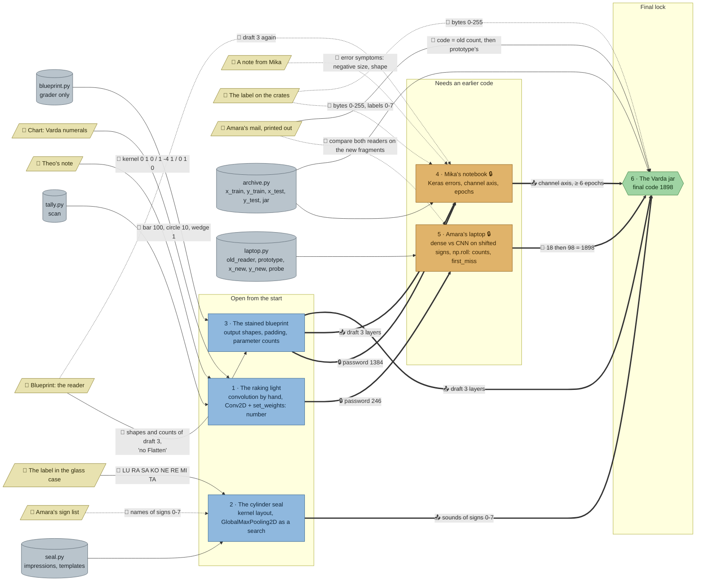

# The Varda Tablets: flow

What a team has to carry from where to where in `nn-tablets`. Hand-maintained with the `room-flow` skill; update it when the room's puzzles, clues, reveals or locks change. Values and solutions: [the walkthrough](../walkthroughs/nn-tablets.en.md).

| Arrow | Meaning |
|---|---|
| `==>` thick | A result, lock code or final digit moves from one station to another |
| `-->` solid | A clue or data file the station can't be solved without |
| `-.->` dotted | Context only: the value is also in the task text or starter, or it only helps to judge a result that isn't checked |

## Phases

- **Start:** 3 stations open at once (raking light, seal, blueprint). Enough for a team of 3; a team of 5 pairs up on the seal (kernel layout) and the tally (two loops plus Keras).
- **Second wave:** Mika's notebook opens with the blueprint's 1,384, Amara's laptop with the tally's 246. Both can run in parallel.
- **Final:** the jar's cabinet needs the laptop's two counts and Amara's mail; the task needs the seal's sounds, draft 3 and the notebook's fixes.

## Chains

- Blueprint → notebook → jar and tally → laptop → jar: 3 stations each, the longest paths.
- Seal → jar: 2 stations; the seal can be done any time before the end.
- The two long chains share no station, so two sub-teams can each take one.

## Hand-offs

- Between stations: 2 lock codes (1384, 246), the final code (1898), and 4 results (draft 3 into the notebook and the jar, the sounds into the jar, the notebook's fixes into the jar).
- From clues: 8 clues; hard: Theo's note, the numeral chart, the seal's label, the blueprint, Amara's mail (for the jar's code). Soft: the sign list, Mika's note, the crate label, and Amara's mail at the laptop.

## Where things are

The museum basement has five parts: the stone vestibule at the foot of the stairs (the exit, the handbook, where the team arrives), the small gallery to its left, Amara's office to its right, the restoration lab below, and the crate store beside the lab, reached from the lab or from the office.

- Next to their station: the seal's label (beside the glass case, in the gallery), the blueprint (on the wall right above its computer, in the office), Amara's mail (on the desk beside her laptop), Theo's note (on the wall above the light table), Mika's note (on the desk beside Mika's laptop).
- On the gallery's wall, a few steps from the seal: the numeral chart and the sign list; the numerals are needed at the light table in the lab, a walk through the vestibule.
- In the crate store: the crate label, 3 tiles from the open crate, and the jar's display cabinet, packed for the morning flight. The jar's team walks through the lab past Mika's desk to reach it.

## Findings

Fixed in the second review (every clue once, no pointers to clues outside the hints, a clear goal per station):

- **No task names its clues any more.** The raking light no longer says Theo's note explains the method or asks for "Theo's kernel" (task, starter and check messages); its check no longer says "count with the numeral chart"; the seal no longer says "her sign list"; the jar no longer says "the way the blueprint and the fixed notebook say", its check no longer says "from the seal", and its lock text no longer says "Amara's mail says how the code is made" (the rule is only in the mail now). Mika's starter says "the reader, draft 3" instead of "the reader from Amara's blueprint", and the reader check no longer says "from the blueprint". Where to look is in the first hint (Theo's note at the raking light, the glass-case label at the seal).
- **Every clue once.** Theo's note no longer repeats the task's step-by-step convolution or the "loses one point on every side" (hint 1 has the shape); Mika's note no longer repeats the lock's password rule or the starter's "2 epochs"; Amara's mail no longer repeats the laptop task's "trained on the photo set, every sign in the middle"; the laptop's check no longer restates the crate label's 0.0 to 1.0; the reader check no longer gives away the blueprint's stained total (1,384).
- **Every station starts with its question:** "What number does it record?", "Which sound does each Varda sign stand for?", "Which reader copes with that, and why does the other one fail?", "What does the lid say?". The laptop's commented-out `np.roll` line in the starter is gone (the task already shows the call).

Earlier findings:

- **The sign list is soft.** The seal's task says filter `i` is `templates[i]`, so the numbers come with the data; the list only names the signs (and helps to read the lid by eye). Left as it is: it gives the script a face, and the reveal repeats the names.
- **The crate label is soft.** Mika's script already scales with `/ 255`; the label only confirms it. Night Post teaches scaling; here it's context on purpose.
- **Mika's note is soft:** it only describes the errors; the third bug (2 epochs) is the starter's own comment.
- **The final retrains the reader** (about 4 s), as the notebook did, because stations don't share a namespace. A team that kept the notebook's code just copies it.
- **The prototype could read the lid,** but the jar station doesn't load it (nor the stamps), and its check wants a reader trained there. Good as it is.
- `uses` on the notebook (`blueprint`) was missing at first; added, since its check enforces draft 3's layout.
