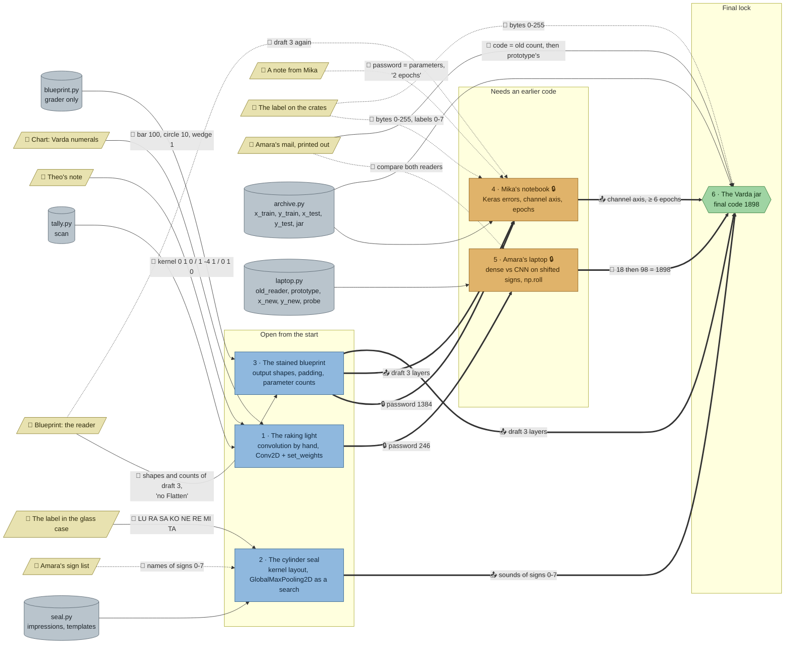

# The Varda Tablets: flow

What a team has to carry from where to where in `nn-tablets`. Hand-maintained with the `room-flow` skill; update it when the room's puzzles, clues, reveals or locks change. Values and solutions: [the walkthrough](../walkthroughs/nn-tablets.en.md).

| Arrow | Meaning |
|---|---|
| `==>` thick | A result, lock code or final digit moves from one station to another |
| `-->` solid | A clue or data file the station can't be solved without |
| `-.->` dotted | Context only: the value is also in the task text or starter, or it only helps to judge a result that isn't checked |

## Phases

- **Start:** 3 stations open at once (raking light, seal, blueprint). Enough for a team of 3; a team of 5 pairs up on the seal (kernel layout) and the tally (two loops plus Keras).
- **Second wave:** Mika's notebook opens with the blueprint's 1,384, Amara's laptop with the tally's 246. Both can run in parallel.
- **Final:** the jar's cabinet needs the laptop's two counts and Amara's mail; the task needs the seal's sounds, draft 3 and the notebook's fixes.

## Chains

- Blueprint → notebook → jar and tally → laptop → jar: 3 stations each, the longest paths.
- Seal → jar: 2 stations; the seal can be done any time before the end.
- The two long chains share no station, so two sub-teams can each take one.

## Hand-offs

- Between stations: 2 lock codes (1384, 246), the final code (1898), and 4 results (draft 3 into the notebook and the jar, the sounds into the jar, the notebook's fixes into the jar).
- From clues: 8 clues; hard: Theo's note, the numeral chart, the seal's label, the blueprint, Amara's mail (for the jar's code). Soft: the sign list, Mika's note, the crate label, and Amara's mail at the laptop.

## Where things are

- Next to their station: Theo's note (tally), the seal's label (seal), the blueprint above its computer, Mika's note (notebook), Amara's mail beside the laptop.
- On the north wall, a few steps away: the numeral chart (above, between tally and seal) and the sign list.
- The crate label stands at the east end of the first row, the jar in the second row: the jar's team walks past the notebook to reach it.

## Findings

- **The sign list is soft.** The seal's task says filter `i` is `templates[i]`, so the numbers come with the data; the list only names the signs (and helps to read the lid by eye). Left as it is: it gives the script a face, and the reveal repeats the names.
- **The crate label is soft.** Mika's script already scales with `/ 255`; the label only confirms it. Night Post teaches scaling; here it's context on purpose.
- **Mika's note repeats the lock text** (password = parameters). The "2 epochs" line is the useful part: it hints at the third bug.
- **The final retrains the reader** (about 4 s), as the notebook did, because stations don't share a namespace. A team that kept the notebook's code just copies it.
- **The prototype could read the lid,** but the jar station doesn't load it (nor the stamps), and its check wants a reader trained there. Good as it is.
- `uses` on the notebook (`blueprint`) was missing at first; added, since its check enforces draft 3's layout.
