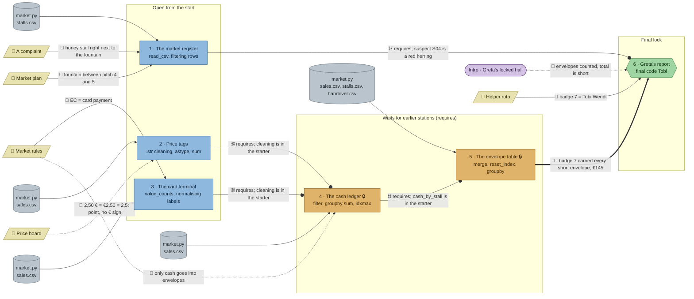

# Market Day: flow

What a team has to carry from where to where in `pandas-market`. Hand-maintained with the `room-flow` skill; update it when the room's puzzles, clues, reveals or locks change. Values and solutions: [the walkthrough](../walkthroughs/pandas-market.en.md).

All five data nodes are the same file, `market.py`, which writes the three CSVs; they are drawn per station to show which tables each task reads.

| Arrow | Meaning |
|---|---|
| `==>` thick | A result, lock code or final word moves from one station to another |
| `-->` solid | A clue or data file the station can't be solved without |
| `-.->` dotted | Context only: the value is also in the task text or the data, or it only helps to judge a result that isn't checked |
| `--o` circle | `requires`: the game waits for the earlier station, but no knowledge moves |

## Phases

- **Start:** 3 stations open at once (register, price tags, card terminal). Fits a team of 3; a team of 5 pairs up.
- **Second wave:** the cash ledger opens once both price tags and the card terminal are solved, then the envelope table once the ledger is solved. Width 1 each: one person types, the rest watch.
- **Final:** the report opens once the register and the envelope table are solved, and needs badge 7 and the helper rota.
- Parallel width per phase: 3, 1, 1, 1.

## Chains

- Price tags (or card terminal) → cash ledger → envelope table → report: 4 stations, the longest path.
- Register → report: 2 stations.
- The long chain is strictly serial after the first wave; only the register runs beside it.

## Hand-offs

- Between stations: 1 piece of knowledge (badge 7, envelope table → report), plus 4 `requires` that move nothing.
- From clues: 6 clue edges from 5 clues; 4 hard (complaint, market plan, market rules → card terminal, helper rota), 2 soft (price board, market rules → ledger).

## Where things are

The map is 22 × 15 tiles.

- Next to their station: the complaint (about 4 tiles from the register) and the price board (about 3.5 tiles from the price tags, and as close to the register).
- On the north wall, away from their stations: the market plan (north-west, about 11 tiles from the register), the market rules (about 8.5 tiles from the card terminal and 9 from the ledger) and the helper rota (north-east, about 11 tiles from the report in the south-east corner).

## Findings

- **All four `requires` are mechanical.** The ledger's starter code already contains the cleaning from price tags and card terminal, and the envelope table's starter already computes `cash_by_stall`, so no result moves along them.
  - Ledger ← price tags, card terminal: could become `uses` by dropping the cleaning lines from the starter (the team brings its own code), or a code lock from their reveals (e.g. the 128 cash sales, or €1,889).
  - Envelope table ← ledger: could become a code lock on the reveal's €1,110 (e.g. PIN 1110), or `uses` by dropping `cash_by_stall` from the starter.
  - Report ← register: the register's answer (S04) is a red herring and not needed for "Tobi"; the `requires` only forces the team to meet the suspicion before the report. Fine as story, but it could go, or become a hint-level link.
  - Report ← envelope table: redundant with the hard badge-7 edge, though it stops guessing the name from the rota alone.
- **The middle of the room is a single-file chain.** After the first wave only one station is open at a time for two phases; a team of 4–5 idles. Turning the ledger's `requires` into `uses` doesn't fix that; a second parallel station in phase 2 would.
- **The price board is soft.** The starter prints `sales["price"].unique()`, which shows every spelling; the board only confirms what the data already says.
- **Market rules → ledger is soft.** The ledger task says "keep only the cash sales"; the clue's §5 only explains why.
- **The final answer depends on one station.** Only the envelope table (badge 7) and the rota feed "Tobi"; price tags, card terminal and ledger contribute only through `requires` and the starter code.
- **The market rules hang far from the card terminal**, its only hard use, which is good for walk-and-talk but the clue is easy to overlook; the card terminal's hint 2 points to it.
