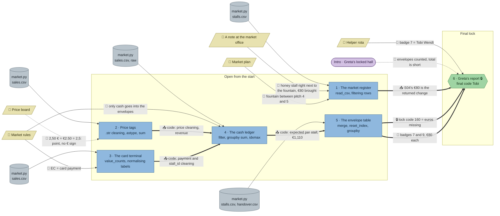

# Market Day: flow

What a team has to carry from where to where in `pandas-market`. Hand-maintained with the `room-flow` skill; update it when the room's puzzles, clues, reveals or locks change. Values and solutions: [the walkthrough](../walkthroughs/pandas-market.en.md).

All five data nodes are the same file, `market.py`, which writes the three CSVs; they are drawn per station to show which tables each task reads. The ledger's starter loads `sales.csv` raw, and the envelope table's starter loads only `stalls.csv` and `handover.csv`: the cleaning and `expected` have to come from the stations that wrote them.

| Arrow | Meaning |
|---|---|
| `==>` thick | A result (here: working code), lock code or final word moves from one station to another |
| `-->` solid | A clue or data file the station can't be solved without |
| `-.->` dotted | Context only: the value is also in the task text or the data, or it only helps to judge a result that isn't checked |

No `requires` are left in this room.

## Phases

- **Start:** all five code stations can be opened at once. Three are self-contained (register, price tags, card terminal). The cash ledger and the envelope table can be started (the ledger's `groupby`, the envelope table's `handover` × `stalls` merge) but only finish with code from other stations.
- **Hand-over wave:** price tags + card terminal → ledger → envelope table. Each hand-over is a paste of a teammate's code, not a wait for the game; the person at the next station has already written their own part.
- **Final:** the report's lock opens with the envelope table's 160; the name needs the envelope table's two €80 badges (7 and 9), the register's S04 (to rule out one of them) and the helper rota.
- Effective parallel width: about 4–5 at the start (3 full stations plus 1–2 preparing), then 2, then 1. Fits a team of 2–5.

## Chains

- Price tags (or card terminal) → cash ledger → envelope table → report: 4 stations, the longest path, now carried by code rather than `requires`.
- Register → report: S04 (the fountain honey stall) rules out badge 9's €80 shortfall, so badge 7 is left. Short and independent of the cleaning chain, so the register is no longer a dead end.

## Hand-offs

- Between stations: 6 pieces of knowledge (cleaning code ×2 → ledger, `expected` → envelope table, `S04` from the register, lock code 160 and the two €80 badges from the envelope table → report).
- From clues: 7 clue edges from 5 clues; 5 hard (complaint and market plan → register, market rules → card terminal, market rules → ledger, helper rota), 1 soft (price board).

## Where things are

The map is 22 × 15 tiles.

- Next to their station: the note (the complaint clue) (about 4 tiles from the register) and the price board (about 3.5 tiles from the price tags, and as close to the register).
- On the north wall, away from their stations: the market plan (north-west, about 11 tiles from the register), the market rules (about 8.5 tiles from the card terminal and 9 from the ledger) and the helper rota (north-east, about 11 tiles from the report in the south-east corner).

## Findings

Fixed in the shortcut review:

- **The skimmer's badge could be read off `handover.csv`.** Badge 7 carried four envelopes and every other badge two, so "who carries the most envelopes" named Tobi without a single station, and the report's name did not depend on the ledger chain (only the lock code did). Badge 9 now also carries four envelopes, so the count is a tie; only the corrected `expected` shows which badges are short. Tested: with a wrong `expected` (no payment filter, no `strip`, no stall id cleaning) the code is not 160, so the lock still needs the full cleaning chain.
- **Tested, not a shortcut:** skipping the card terminal's `EC` rename still gives 160 (only `cash` is filtered), but the `strip` on `payment` and the `stall_id` cleaning are needed; wrong price cleaning gives badge 12 and 0.5. Without the payment `strip` the total is −402.20, without the `stall_id` cleaning −48.10, and without the price comma fix it is far off, so the lock's 160 can't be reached from the handover sums without `expected`.
- **Fixed in step 23 (the register feeds the final).** The complaint became an honest customer's note: the woman at the honey stall next to the fountain gave change for a hundred on a twenty, and the customer brought the €80 back to the office. So Imkerei Sommer's envelope (S04, badge 9, Ben) is €80 short, honestly. Tobi (badge 7) took €80 from Bienenhaus Okafor's envelope (S07, the other honey stall). The envelope table now shows two €80 shortfalls, one per badge (7 and 9), and cannot name the thief alone. Both honey stalls being short means "the honey one" is not enough: the team needs the pitch (S04 at pitch 4, next to the fountain; S07 at pitch 9) from the register and the market plan to see which shortfall the returned change explains. The report's hints walk that path. The lock code is 160, the euros missing in total.
- **Wrong cleaning gives a different total** (tested): without the payment strip −402.20, without the `stall_id` cleaning −48.10, without the price comma fix far off. Skipping the `EC` rename still gives 160. So the lock still needs the cleaning chain.
- **Left: the final answer can still be guessed** between two names (Tobi, Ben), since there is no attempt limit.

Fixed in the second review (every clue once, no pointers to clues or other stations outside the hints, a clear goal per station):

- **No task or starter names another station any more.** The ledger's task no longer says the cleaning comes from the price tags and the card terminal, and its starter only lists the columns to clean; the envelope table's task and starter no longer mention the cash ledger's code or `expected`. Hint 1 of each now says where that code comes from.
- **No task names its clue.** The register's task no longer mentions the complaint (it says one stall is suspected of short-changing a customer), and its starter comment no longer says "the stall in the complaint". Hint 1 of the register, the price tags and the card terminal now says where the complaint, the market plan, the price board and the market rules are.
- **The cash-only rule lives only in §5 of the market rules.** The intro no longer says "cash envelope", the ledger's task drops "Careful: not every sale goes into an envelope" (its goal, the sales that belong in the envelopes, stays), and the helper rota no longer repeats that each badge collects the cash envelopes. The price tags' task no longer repeats the price board's "written a different way at every stall".
- **Left:** every station already ends in checked values, so no booleans were added; the report's lock note ("Code = the euros missing in total") is the lock's own text, not a pointer.

Fixed (the first review):

- **Fixed: all four `requires` are gone.** The ledger's starter no longer contains the cleaning (`uses` price tags and card terminal), the envelope table's starter no longer computes the expected cash (`uses` the ledger; the Series is now called `expected`), and the report sits behind a code lock whose code (the euros missing, then 145, now 160) is in the envelope table's reveal. The lock replaces both of the report's `requires`, including the one that guarded against guessing a name from the rota.
- **Fixed: the middle is no longer single-file.** Ledger and envelope table are open from the start, so their own parts (filter + `groupby`; the `handover` × `stalls` merge) run beside the first three stations, and only the hand-over of code waits.
- **Fixed: market rules → ledger is hard.** The task no longer says "keep only the cash sales", the variable is no longer `cash_by_stall`, and the card terminal's reveal no longer says that only cash went into the envelopes; §5 of the market rules is the source, and hint 1 points to it.
- **Left: the price board is soft.** It describes spellings that `sales["price"].unique()` shows anyway. Giving it a hidden rule (cents, deposits) would add a conditional cleaning step to the easiest station; it stays as context.
- **Partly left: the final answer still comes from one station.** The envelope table hands over both the lock code and badge 7, but it can only be solved with the code of the ledger, price tags and card terminal, so four stations now feed the final through real hand-offs.
- **The market rules hang far from the card terminal and the ledger**, its hard uses: good for walk-and-talk, easy to overlook; hints point to it at both stations.
