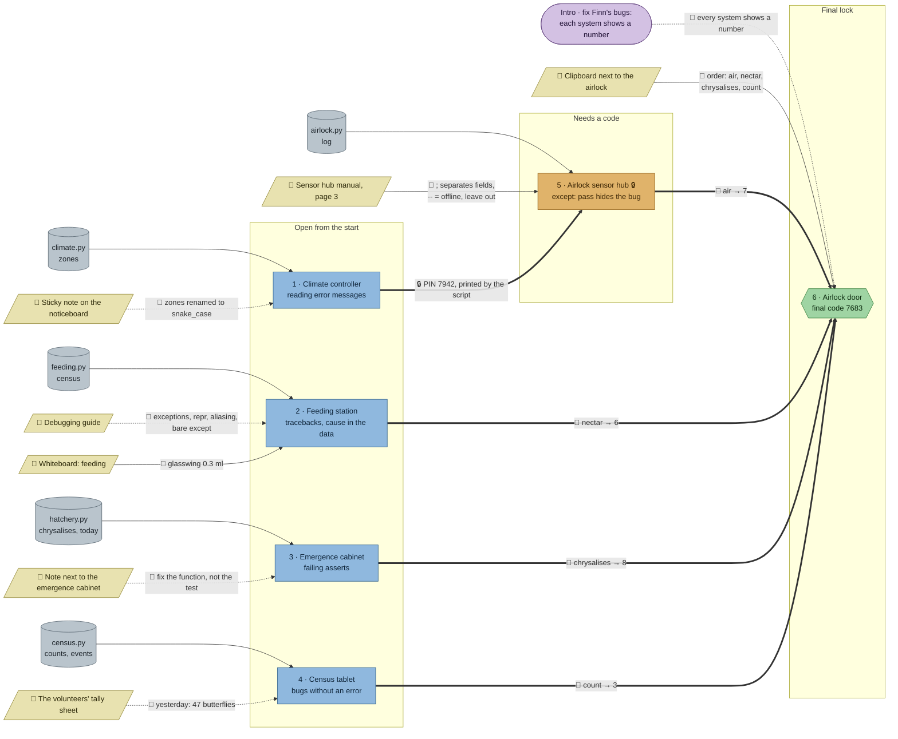

# The Butterfly House: flow

What a team has to carry from where to where in `python-debug`. Hand-maintained with the `room-flow` skill; update it when the room's puzzles, clues, reveals or locks change. Values and solutions: [the walkthrough](../walkthroughs/python-debug.en.md).

Every station is a prewritten script with bugs; most of the knowledge a team needs comes from Python's own error messages, so the clues are lighter than in other rooms.

| Arrow | Meaning |
|---|---|
| `==>` thick | A result, lock code or final digit moves from one station to another |
| `-->` solid | A clue or data file the station can't be solved without |
| `-.->` dotted | Context only: helps to find or judge something, or the station can be solved without it |

## Phases

- **Start:** 4 stations open at once (climate controller, feeding station, emergence cabinet, census tablet). Enough for a team of 4; a team of 5 pairs up on the feeding station, which has the most errors (four in a row).
- **Second wave:** the sensor hub opens with the PIN the fixed climate script prints. The climate controller is the shortest station, so the hub opens early.
- **Final:** the airlock needs four digits and the checklist's order.

## Chains

- Climate controller → sensor hub → airlock: 3 stations, the longest path.
- Every other station → airlock: 2 stations.

## Hand-offs

- Between stations: 1 (the PIN), plus 4 digits into the airlock.
- From clues: 6 clues, 3 hard (whiteboard, sensor manual, checklist) and 3 soft (Finn's note, the cabinet note, the tally sheet).
- From the scripts themselves: most of the knowledge comes from the error messages and tests, which is the point of the room.

## Where things are

- Every clue stands next to its station: Finn's note two tiles from the climate panel, the whiteboard above the feeding station, the cabinet note two tiles from the cabinet, the tally sheet and the sensor manual two tiles from their desks, the checklist beside the keypad.
- North half: climate panel and Finn's note (west wall), feeding station and whiteboard (east), keypad and checklist by the door. A hedge of plant beds splits the room; the census tablet and sensor hub stand in the south half.
- The handbook stands in the north-east corner.

## Findings

- **Three clues are soft.** Finn's note explains the `KeyError: 'cloud_forest'`, but the message alone is enough. The tally sheet (47 yesterday) confirms the census bug, but all-zero changes already give it away. The cabinet note only says to trust the tests. That's partly on purpose: in a debugging room, Python's own messages are the main clue.
- **Clues sit next to their stations,** so there's little walking and talking between lanes. A link could be: the census tablet's `events` come from the hatchery's results, or the feeding station's species list comes from the census.
- **"nectar → 6" isn't derived from the script's output,** unlike air → 7 (valid readings), chrysalises → 8 (due this week) and count → 3 (species to order). It could become the number of a feeder or a value the fixed script prints.
- **Order of errors:** the climate script shows its `NameError` before the `KeyError` (the first zone exists), and the feeding script's `TypeError` comes before the missing glasswing. The hints list the bugs without an order, so this is fine.
