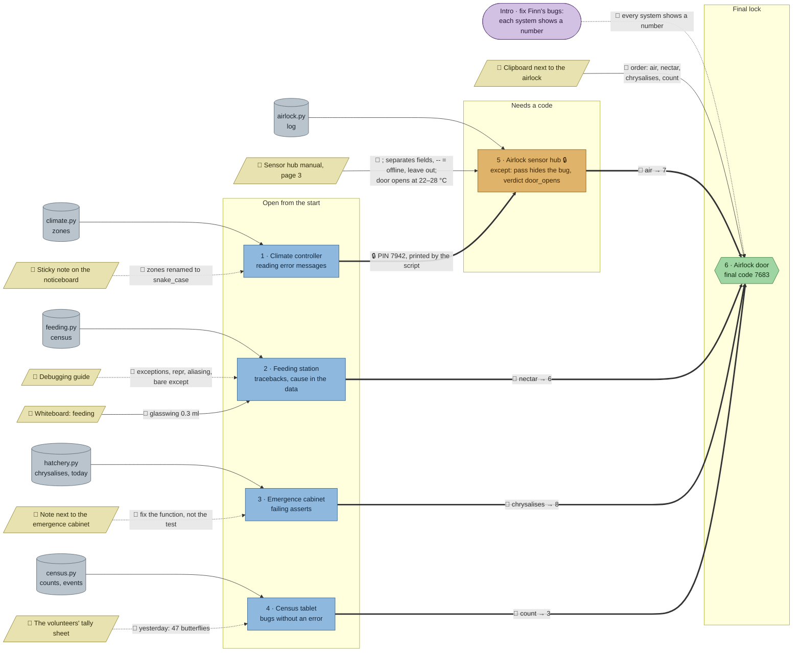

# The Butterfly House: flow

What a team has to carry from where to where in `python-debug`. Hand-maintained with the `room-flow` skill; update it when the room's puzzles, clues, reveals or locks change. Values and solutions: [the walkthrough](../walkthroughs/python-debug.en.md).

Every station is a prewritten script with bugs; most of the knowledge a team needs comes from Python's own error messages, so the clues are lighter than in other rooms.

| Arrow | Meaning |
|---|---|
| `==>` thick | A result, lock code or final digit moves from one station to another |
| `-->` solid | A clue or data file the station can't be solved without |
| `-.->` dotted | Context only: helps to find or judge something, or the station can be solved without it |

## Phases

- **Start:** 4 stations open at once (climate controller, feeding station, emergence cabinet, census tablet). Enough for a team of 4; a team of 5 pairs up on the feeding station, which has the most errors (four in a row).
- **Second wave:** the sensor hub opens with the PIN the fixed climate script prints. The climate controller is the shortest station, so the hub opens early.
- **Final:** the airlock needs four digits and the checklist's order.

## Chains

- Climate controller → sensor hub → airlock: 3 stations, the longest path.
- Every other station → airlock: 2 stations.

## Hand-offs

- Between stations: 1 (the PIN), plus 4 digits into the airlock.
- From clues: 6 clues, 3 hard (whiteboard, sensor manual, checklist) and 3 soft (Finn's note, the cabinet note, the tally sheet). The sensor manual's door range (22–28 °C) is now checked through `door_opens`.
- From the scripts themselves: most of the knowledge comes from the error messages and tests, which is the point of the room.

## Where things are

- Every clue stands next to its station: Finn's note two tiles from the climate panel, the sensor manual two tiles from the sensor hub, the whiteboard above the feeding station, the cabinet note two tiles from the cabinet, the tally sheet two tiles from the census desk, the checklist beside the keypad.
- Players arrive in the airlock (top centre) with the door, keypad, checklist and handbook. West of it is Ole's tech room with the climate panel and the sensor hub; a strip curtain leads south into the tropical hall: the feeding corner in the north-east, the emergence cabinet on the west side, the lily pond in the middle and the volunteers' desk with the census tablet in the south-east.

## Findings

Fixed in the shortcut review:

- **A station could be passed without fixing anything.** All checks only compared the final variables, so typing the expected `heater`, `misters`, `changes`, `order`, `tonight` or `this_week` as literals (worked out by hand from the printout) passed. Now the starters put the logic in functions (`levels`, `evening`, `air_readings`; `feeder_total` and `due` already were) and every check also calls that function on a second input defined in the data file (`_later_zones`, `_counts2`/`_events2`, `_night_log`, `_late_feeder`, `due` on other days). A hard-coded answer fails with a `NameError`, and a function that is only fixed for the first input fails too. The task texts say that the check calls the function.
- **The census check alone was easy to half-fix:** `yesterday = counts.copy()` with the `remove` loop kept already gave the right `changes`. The second evening has two adjacent empty species, so the skipping loop is caught on its own (and the first input already caught it through the order list).
- Tried and failed as intended: counting `--` as 0 (door `False`), skipping the comma readings, `NECTAR.get(..., 0)` instead of adding glasswing, dropping the `0 <=` in `due` (the room's own tests catch it), fixing only the alias in `census`, renaming the zones in `zones` instead of `TARGETS` (the later hour still has `cloud_forest`).

Still open:

- **A digit can still be computed by hand** from the small data (the census order, the valid air readings), but not the results the checks verify, and every final digit is only shown in a reveal. A bigger fix would be a longer data set per station.
- **`except: pass` station:** deleting the `try` and fixing by trial is the intended route.

Fixed earlier, in the second review (every clue once, no pointers to clues outside the hints, a clear goal per station):

- **The sensor hub ends in a verdict:** the task asks whether the inner door may open, and the check now verifies `door_opens` (`True`) next to the readings and the mean. The manual's 22–28 °C rule used to be read only in the reveal; a team that counts `--` as 0 °C gets a mean of 16.7 °C and `False`.
- **Every clue says its thing once.** The feeding whiteboard no longer repeats the four nectar values from the starter's `NECTAR` (only the new glasswing); the tally sheet no longer repeats the census task (only "47 yesterday"); the cabinet note no longer repeats the starter's "they all passed before"; the checklist no longer repeats the intro ("every system shows a number") or the climate task (its PIN opens the sensor hub).
- **The airlock door's task no longer repeats the intro** about restart numbers.

Still open (from the first review):

- **Three clues are soft.** Finn's note explains the `KeyError: 'cloud_forest'`, but the message alone is enough. The tally sheet (47 yesterday) confirms the census bug, but all-zero changes already give it away. The cabinet note only says to trust the tests. That's partly on purpose: in a debugging room, Python's own messages are the main clue.
- **Clues sit next to their stations,** so there's little walking and talking between lanes. A link could be: the census tablet's `events` come from the hatchery's results, or the feeding station's species list comes from the census.
- **"nectar → 6" isn't derived from the script's output,** unlike air → 7 (valid readings), chrysalises → 8 (due this week) and count → 3 (species to order). It could become the number of a feeder or a value the fixed script prints.
- **Order of errors:** the climate script shows its `NameError` before the `KeyError` (the first zone exists), and the feeding script's `TypeError` comes before the missing glasswing. The hints list the bugs without an order, so this is fine.
