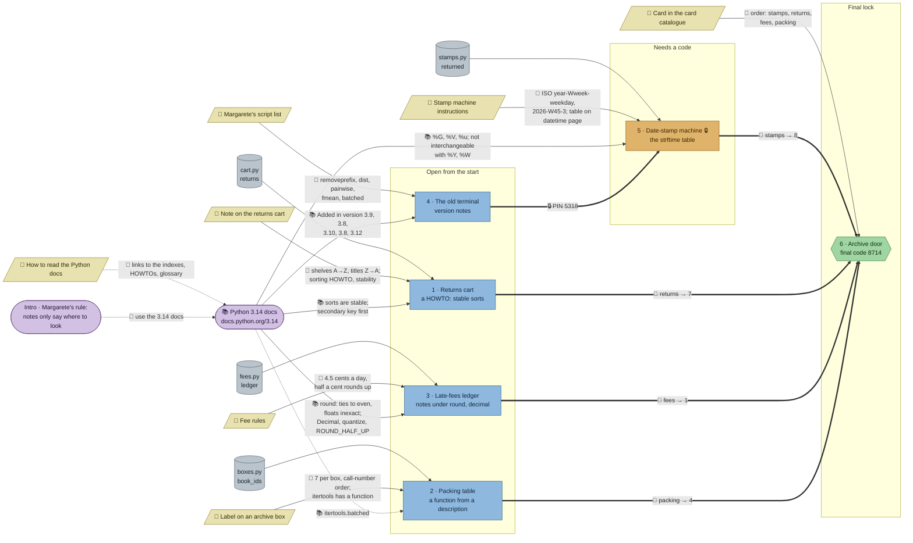

# The Silent Archive: flow

What a team has to carry from where to where in `python-docs`. Hand-maintained with the `room-flow` skill; update it when the room's puzzles, clues, reveals or locks change. Values and solutions: [the walkthrough](../walkthroughs/python-docs.en.md).

This room has one source the others don't: the official Python 3.14 documentation, open in another browser tab. It is drawn as its own node, with an edge to every station that needs a fact from it.

| Arrow | Meaning |
|---|---|
| `==>` thick | A result, lock code or final digit moves from one station to another |
| `-->` solid | A clue, data file or doc fact the station can't be solved without |
| `-.->` dotted | Context only: helps to find something, or the station can be solved without it |

## Phases

- **Start:** 4 stations open at once (returns cart, packing table, late-fees ledger, old terminal). Enough for a team of 4; a team of 5 pairs up on the ledger, the longest read.
- **Second wave:** the date-stamp machine opens with the terminal's PIN.
- **Final:** the door needs the four digits and the card catalogue's order.

## Chains

- Old terminal → date-stamp machine → door: 3 stations, the longest path. Both are version and table lookups, so one docs-confident player can take the whole chain.
- Every other station → door: 2 stations.

## Hand-offs

- Between stations: 1 (the PIN), plus 4 digits into the door.
- From clues: 6 clues, all hard. The handbook only helps to find pages in the docs.
- From the docs: 5 stations need a doc fact; 4 of them can't pass without it.

## Where things are

- The room has five parts: the reading hall with the sealed door in the middle, the stacks to the west, Margarete's office to the north-east, the packing room with the cellar stairs south of the hall and the circulation desk to the south-east.
- Next to their station: the cart note (on the stacks' north wall, above the cart), the script list (pinned on the office wall beside the terminal), the box label (on a stack of boxes two tiles from the packing table), the stamp instructions (on the wall above the stamp machine, in the circulation room).
- Away from their station: the fee rules hang on the circulation room's east wall, three tiles from the ledger desk, so they're near but not on it. The card catalogue stands in the reading hall by the door, the door's keypad on the north wall beside it.
- The handbook stands on a reading stand in the hall, next to where players arrive; the docs themselves are in another browser tab, so every player reads them on their own screen.

## Findings

- **The packing table doesn't need the docs.** A loop over `sorted(book_ids)` packs the boxes without `itertools.batched`; only the box label is hard. It's also the smallest station (one line with `batched`). Options: ask for a second thing only the `batched` entry says (what happens with `strict=True` on the short last box), or keep it as the gentle start.
- **No station needs another station's result,** only the terminal's PIN. That keeps four lanes open in parallel but means little talk between them, apart from the final digits. A link could be: the fee ledger's titles come off the returns cart, or the stamp tray holds the books from the packing table.
- **The digits are fixed in the reveals,** not derived from the results (as in the other rooms). Fine for the door, but a team could share them across teams.
- **Doc facts are pinned to 3.14.** The version notes never change; the round note, the HOWTO and the format-code table could be reworded in later editions. Re-check when Pyodide's Python moves.
