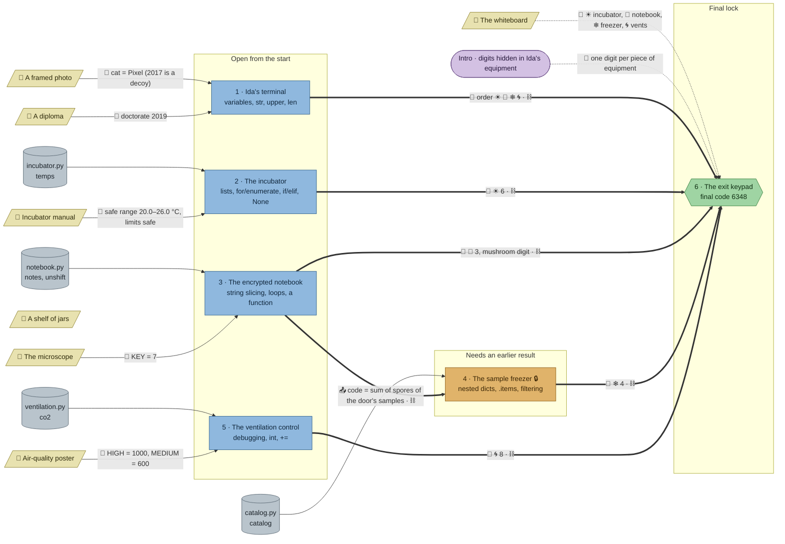

# Quarantine: flow

What a team has to carry from where to where in `python-lab`. Hand-maintained with the `room-flow` skill; update it when the room's puzzles, clues, reveals or locks change. Values and solutions: [the walkthrough](../walkthroughs/python-lab.en.md).

| Arrow | Meaning |
|---|---|
| `==>` thick | A result or final digit moves from one station to another |
| `-->` solid | A clue or data file the station can't be solved without |
| `-.->` dotted | Context only: the value is also elsewhere, or it only helps to read a result |
| `⛓` in a label | The source is also in the target's `requires`: the game keeps the target closed until the source is solved (no lock code; the freezer's 🔒 is this mechanical lock) |

The shelf of jars is flavour only and has no edge.

## Phases

- **Start:** 4 stations open at once (terminal, incubator, notebook, ventilation). Enough for a team of 4; a team of 2–3 takes two each, a team of 5 pairs up on one.
- **Second wave:** the freezer stays closed until the notebook is solved (`requires`), and its padlock rule comes from the notebook's decrypted notes. Only 1 station wide, so most of the team idles or walks to the whiteboard while one sub-team does it.
- **Final:** the keypad waits for all five stations (`requires`) and needs four digits plus the order from the terminal.

## Chains

- Notebook → freezer → exit: 3 stations, the longest path.
- Terminal, incubator, ventilation → exit: 2 stations each.
- The notebook is the bottleneck: it feeds both the freezer and a digit, so a team should start it early.

## Hand-offs

- Between stations: 1 result (the spore-sum rule, notebook → freezer), plus 4 digits and 1 symbol order into the keypad.
- From clues: 7 clues; 5 hard (photo, diploma, manual, microscope, poster), 1 soft (whiteboard), 1 flavour (jars).
- Mechanical: 6 `requires` links (1 into the freezer, 5 into the exit), all of them doubling a knowledge edge.

## Where things are

- Next to their station: the photo (64 px right of the terminal) and the diploma (about 100 px away, same corner).
- Away from their station, so the team has to walk and talk: the incubator manual hangs on the east side next to the freezer (about 320 px from the incubator); the microscope stands in the south middle (about 300 px from the notebook); the air-quality poster is in the west (about 440 px from the ventilation control in the north-east).
- The whiteboard hangs in the north-west by the terminal, about 256 px from the exit keypad.

## Findings

- **The whiteboard is soft.** The terminal's draft already gives the order in symbols (☀ 🍄 ❄ 🌀) and every reveal shows its digit next to its symbol, so the symbol → station key is never needed; only the notebook's "mushroom digit is three" lacks a symbol, and "mushroom" reads as 🍄 on its own. To make it hard, have the draft give the order by station names (or the reveals show only symbols and the draft names stations), so the whiteboard's key is the bridge.
- **The whiteboard says "one digit from each station", but the terminal gives none** (it gives the order). Five stations, four digits: teams may hunt for a terminal digit. Hint 1 of the keypad repeats the same wording.
- **Freezer `requires: ["notebook"]` could become `uses: ["notebook"]`.** The knowledge already travels (the spore-sum rule is nowhere in the freezer's task), so the freezer could open from the start and widen the first wave to 5; the team would explore the catalogue and the smudged label while the notebook is decoded. Alternatively the notes could end in a short code and the freezer get a `lock` with `from: "notebook"`.
- **The exit's five `requires` duplicate its knowledge edges.** The code can't be read without the four digits and the draft's order, so they could all become `uses` (or be dropped); keeping them only guards a 4-digit keypad against guessing.
- **The microscope's KEY = 7 is brute-forceable** (26 values, and the notes read as plain text at the right one), so it is hard for the check but a determined team can skip the walk. Minor at beginner level.
- **The manual is only half needed:** "None means the sensor dropped out" is also in the data file's comment and the task; the safe range and "limits still safe" are the hard part.
- **The shelf of jars is flavour only**, as intended; no station uses it.
