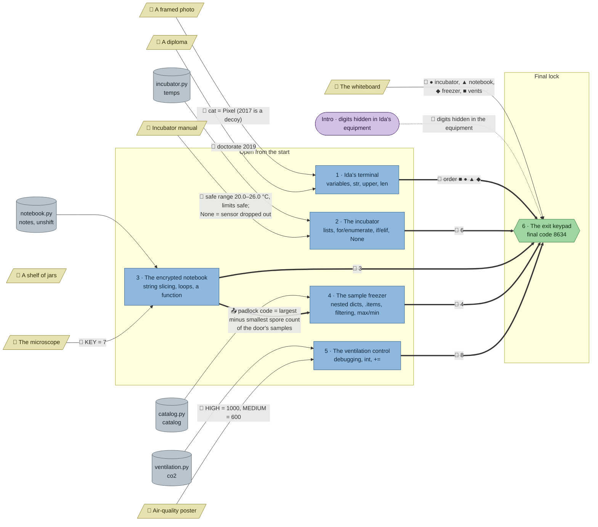

# Quarantine: flow

What a team has to carry from where to where in `python-lab`. Hand-maintained with the `room-flow` skill; update it when the room's puzzles, clues, reveals or locks change. Values and solutions: [the walkthrough](../walkthroughs/python-lab.en.md).

| Arrow | Meaning |
|---|---|
| `==>` thick | A result or final digit moves from one station to another |
| `-->` solid | A clue or data file the station can't be solved without |
| `-.->` dotted | Context only: the value is also elsewhere, or it only helps to read a result |

The shelf of jars is flavour only and has no edge.

## Phases

- **Start:** all 5 stations open at once (terminal, incubator, notebook, freezer, ventilation). Enough for a team of 5; a team of 2–4 takes two each.
- **Second wave:** none mechanically. The freezer is open, and its catalogue work (finding the smudged sample M-13) can start right away, but the padlock rule is only in the notebook's decrypted notes, so the freezer team has to wait for or ask the notebook team.
- **Final:** the keypad is open from the start (no `requires`) and needs four digits, the terminal's shape order and the whiteboard's shape key. The intro is the only place that says the digits are spread over the equipment.

## Chains

- Notebook → freezer → exit: 3 stations, the longest path.
- Terminal, incubator, ventilation → exit: 2 stations each; the terminal's order also needs the whiteboard.
- The notebook is the bottleneck: it feeds both the freezer and a digit, so a team should start it early.

## Hand-offs

- Between stations: 1 result (the padlock rule, notebook → freezer), plus 4 digits and 1 shape order into the keypad.
- From clues: 7 clues; 6 hard (photo, diploma, manual, microscope, poster, whiteboard), 1 flavour (jars).
- Mechanical: none. The freezer and the exit list their sources in `uses`.

## Where things are

- Next to their station: the photo (64 px right of the terminal) and the diploma (about 100 px away, same corner).
- Away from their station, so the team has to walk and talk: the incubator manual hangs on the east side next to the freezer (about 320 px from the incubator); the microscope stands in the south middle (about 300 px from the notebook); the air-quality poster is in the west (about 440 px from the ventilation control in the north-east).
- The whiteboard hangs in the north-west by the terminal, about 256 px from the exit keypad.

## Findings

Fixed in the shortcut review (every station adds a needed piece):

- **The override order was the station order.** The terminal's draft said ● ▲ ◆ ■ (incubator, notebook, freezer, vents), which is the order the stations are listed in and the order the keypad's first hint names them, so the first natural guess (6348) opened the door without the terminal. The order is now ■ ● ▲ ◆ (vents, incubator, notebook, freezer), code 8634: not the station order, the hint's order, the whiteboard's listing, the map's reading orders, the digits sorted, or any of these reversed.
- **The freezer's padlock rule was guessable.** "Add up the spore counts of the samples on its door" is what any team tries first with three samples and one numeric field, so the freezer passed (7325) without the notebook. The rule in the notes is now "of the samples listed on its door, the largest spore count minus the smallest" (1270), which nobody guesses; the sum now fails. The handbook gained `max()`/`min()`.
- **The catalogue's shelf column named the smudged sample.** M-04, M-09 and M-13 were the only samples with shelf `"freezer"`, so one filter found M-13 without the handwriting's "only M-1… that glows". The shelves now show where the samples were before the move (B1–B3, among other glowing samples), and the notes say Ida moved her *best* glowing samples, not all of them.

Fixed in the second review (every clue once, no pointers to clues outside the hints, a clear goal per station):

- **No task or starter names its clues any more.** The terminal's task no longer says the values are "things you find in the lab", the incubator's no longer says the manual is somewhere in the lab, the notebook's starter no longer says the key is in the lab, the freezer's task no longer says its rule isn't on the freezer, and the ventilation starter no longer says to copy the thresholds from the poster. Where to look is in each puzzle's first hint (the freezer's hint 1 now carries "how Ida set the code is not on the freezer").
- **"None = the sensor dropped out" lives only on the manual.** The incubator's task and the data file's comment no longer repeat it, so the manual is fully needed.
- **The keypad no longer repeats the intro** ("Ida never kept the whole code in one place"); it now says what to do: enter the override code.
- **Every station's task now opens with its goal** (work out the password, find out how the night went, find the padlock's code). All stations already ended in a checked variable or code.

Fixed (the first review):

- **The whiteboard is now hard.** The reveals show bare digits, the terminal's draft gives the order as neutral shapes, and only the whiteboard maps shapes to stations (listed out of order, so it doesn't give the order away). Before, thematic symbols (☀ ❄ 🌀 🍄) in the reveals made it guessable.
- **"One digit from each station" is gone.** The whiteboard says "4 digits, one per shape", and the keypad's first hint names the four digit stations and says the terminal gives the order.
- **The freezer opens from the start** (`uses: ["notebook"]` instead of `requires`). Its text says the code isn't written on the freezer, and hint 1 sends the team to whoever decodes the notebook.
- **The exit's `requires` are now `uses`**, as in stats-fair's gate. Guessing stays costly: without the whiteboard there are 24 orders, and every wrong try shows in the debrief.

Left as they are:

- **The microscope's KEY = 7 is brute-forceable** (26 values, and the notes read as plain text at the right one). Fine at beginner level; it is also a nice "try all keys" moment.
- **Partial-code guessing:** a team with three digits and the order can try 10 values for the fourth (e.g. skip the freezer). Accepted: wrong attempts are counted in the debrief.
- **The shelf of jars is flavour only**, as intended; no station uses it.
- **Guessed thresholds and ranges fail** (tested in the shortcut review): the vents with 1000/500 or 1000/800 or `>=` give other speeds, and only the poster's 1000/600 with `>` passes; the incubator with inclusive limits (`<=`/`>=`) counts 8 alarms, not 6. The decoy year 2017 fails the terminal. The poster, the manual and the diploma stay needed.
