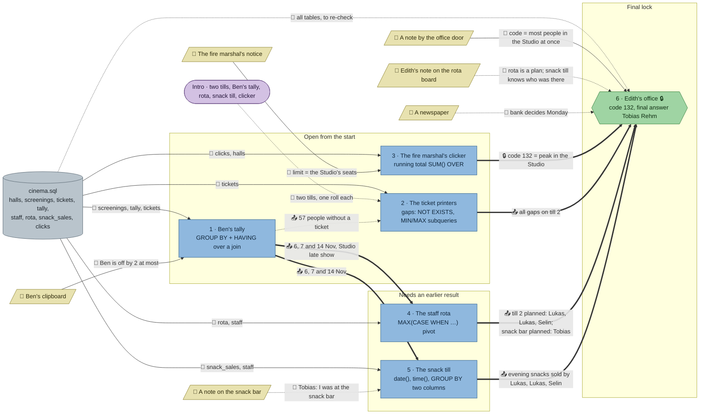

# The Last Show: flow

What a team has to carry from where to where in `sql-cinema`. Hand-maintained with the `room-flow` skill; update it when the room's puzzles, clues, reveals or locks change. Values and solutions: [the walkthrough](../walkthroughs/sql-cinema.en.md).

| Arrow | Meaning |
|---|---|
| `==>` thick | A result or lock code moves from one station to another |
| `-->` solid | A clue or data file the station can't be solved without |
| `-.->` dotted | Context only: the value is also in the task text or the data, or it only helps to judge a result that isn't checked |

All six stations load the same `cinema.sql`, so the room has one data node; the edges name the tables each station needs. The room has no `requires`: the office is behind a code lock, and the rota and the snack till need the dates from Ben's tally (`uses`).

## Phases

- **Start:** 3 stations at once (tally, ticket printers, clicker), each about 4–6 minutes. Enough for a team of 3; in a team of 4–5 the others read the clues and the handbook.
- **Second wave:** the rota and the snack till both need the three dates from the tally, and open together as soon as it is solved, so the room stays 2–3 wide.
- **Final:** the office opens with 132 (clicker + the note by the office door), then needs a name that only printers + rota + snack till give together: till 2 was skimmed, the people planned there sold snacks instead, so the one planned at the snack bar stood at till 2.

## Chains

- Tally → rota → office and tally → snack till → office: 3 stations, the longest paths for the name.
- Ticket printers → office: 2 stations, which till.
- Clicker → office: 2 stations, the lock code.

## Hand-offs

- Between stations: 7 edges, 6 hard (the dates twice, the lock code, till 2, the planned posts, the evening snack sellers) and 1 soft (57 missing tickets, which the printers confirm on their own).
- From clues: 7 clue and intro edges from 6 clues and the intro, 3 of them hard (Ben's margin of 2, the fire limit, the office door code rule).

## Where things are

The room is the cinema's ground floor: the dark Studio with its screen and seats (top left), the art-deco foyer below it with the snack bar, the usher's post at the Studio door and the box office, and the staff room behind the box office (top right) with Edith's office door. Players arrive at the street doors on the right.

- The note by the office door (672, 32) hangs right next to the office (704, 32), but the code comes from the clicker at the Studio door (352, 352), about 480 px away across the foyer.
- Ben's clipboard (224, 320) hangs beside his tally podium (256, 352), and the fire notice (384, 320) beside the clicker (352, 352), both on the Studio's back wall.
- The tally's dates have to travel from the Studio door (256, 352) to the rota computer in the staff room (800, 64), about 610 px, and to the snack bar (96, 384), about 160 px.
- Edith's note on the rota board (736, 32) is about 70 px from the rota computer and next to the office.
- Tobias's note (128, 384) is taped to the end of the snack bar, beside the snack till (96, 384).

## Findings

Fixed in the second review (every clue once, no pointers to clues outside the hints, a clear goal per station):

- **The tally's task no longer points at Ben's clipboard;** the first hint now says where his margin is.
- **The clicker's limit lives only on the fire notice.** The task asks when the Studio was "fuller than the fire department allows" instead of "more people than it has seats", so the notice is now a hard clue (the seat count itself is in `halls`); the first hint says where the limit is. The task and the notice no longer both explain the clicker: the notice keeps the rule, the task the data.
- Nothing the checks compare changed; the starters only show `SELECT * … LIMIT 5`.

Earlier findings:

- **The hard clues stand next to their stations.** The walking comes from the results instead: the tally's dates go across the room to the rota and the snack bar, and the clicker's code across to the office. A playtest should show whether that is enough talking.
- **The ticket printers need no clue:** the task text explains the two rolls. The station still matters, since it is the only one that says the cash went missing at till 2.
- **The trap in the final:** the rota names Lukas Feld and Selin Aydın at till 2, so a team that skips the snack till will likely answer one of them. Tobias's note on the snack bar points at the snack till on purpose: without the evening filter (`time(sold_at) >= '18:15'`) it shows him selling snacks on all three days, which looks like an alibi.
- **The lock can't be taken from Ben's tally:** he let in 134 on the 14th, but two people walked out before the last latecomers came, so the clicker peaks at 132.
- **The tally needs Ben's margin:** without it, `HAVING admitted > COUNT(…)` returns 35 screenings instead of 3.
- **The printers' natural mistake:** without the per-till `MAX`, the last ticket of each roll shows up as a gap (14 rows instead of 12).
- **The newspaper is flavour**, by design.
