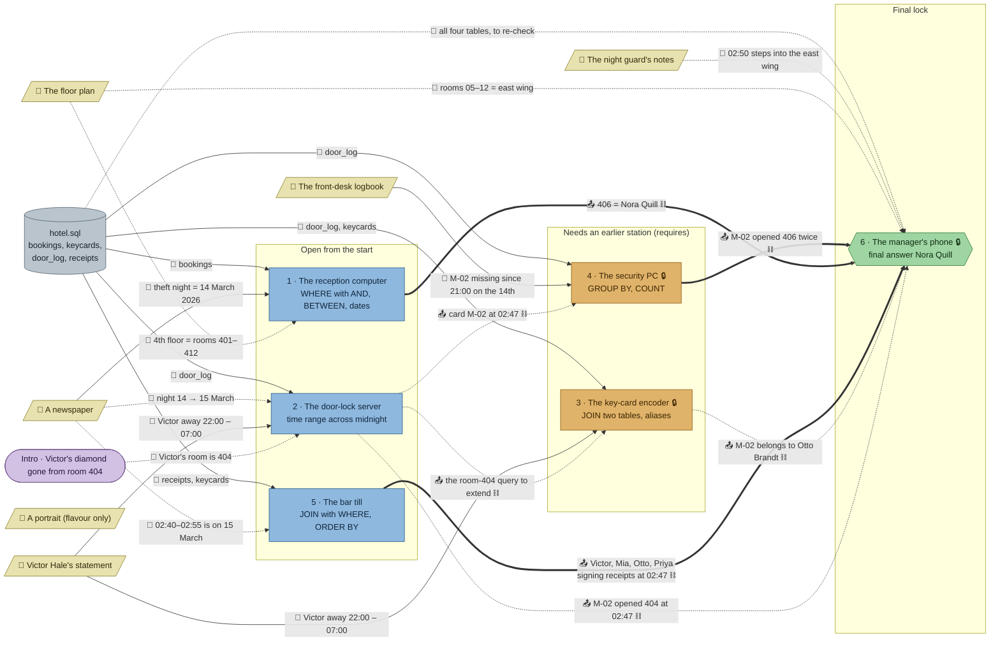

# The Blue Index: flow

What a team has to carry from where to where in `sql-hotel`. Hand-maintained with the `room-flow` skill; update it when the room's puzzles, clues, reveals or locks change. Values and solutions: [the walkthrough](../walkthroughs/sql-hotel.en.md).

| Arrow | Meaning |
|---|---|
| `==>` thick | A result moves from one station to another and the final answer can't be reached without it |
| `-->` solid | A clue or data file the station can't be solved without |
| `-.->` dotted | Context only: the value is also in the task text, the data or another clue, or it only helps to judge a result that isn't checked |
| ⛓ at the end of a label | The target also `requires` the source: it stays closed until the source is solved, whatever the team knows |

All six stations load the same `hotel.sql`, so the room has one data node; the edges name the tables each station needs. 🔒 here marks stations closed by `requires`, not by a code lock (the room has none).

## Phases

- **Start:** 3 stations open at once (reception, door-lock server, bar till). Enough for a team of 3; in a team of 5, two players have nothing to open.
- **Second wave:** the key-card encoder and the security PC both wait for the door-lock server (`requires`). They open together, so the door-lock server is the bottleneck: until it is solved the room is 3 wide, afterwards 4 (reception and bar till may still be running).
- **Final:** the manager's phone waits for all five stations (`requires`), then needs one name.

## Chains

- Door-lock server → security PC → phone and door-lock server → key-card encoder → phone: 3 stations each, the longest paths. They share the door-lock server.
- Reception → phone and bar till → phone: 2 stations each.
- The decisive path is security PC (406 twice) + reception (406 = Nora Quill); the bar till rules out Otto, the obvious suspect.

## Hand-offs

- Between stations: 7 `requires` edges (2 into the second wave, 5 into the phone). Real knowledge moves on 3 of them (406 twice, 406 = Nora Quill, the alibis); the other 4 are context the receiving station can get by itself.
- From clues: 6 clues; 3 hard (newspaper for reception, Victor's statement for the door-lock server and key-card encoder, the logbook for the security PC), the floor plan and the guard's notes soft, the portrait unused. The newspaper is also soft context for the door-lock server and the bar till, though neither lists it.

## Where things are

- Next to their station: the guard's notes (about 100 px from the phone) and the floor plan (on the north wall, about 100 px from reception).
- Away from their stations: the newspaper in the lounge (480, 128), 350 px east of reception; Victor's statement on the manager's desk (544, 320), by the phone and 190–260 px from the door-lock server and key-card encoder; the logbook beside reception (96, 128), about 400 px from the security PC that needs it.
- So all three hard clues force a walk and a hand-over, which is what the design rules ask for.

## Findings

- **The `requires` on the key-card encoder could simply go.** Its task is the door-lock query plus a `JOIN`, solvable from the statement alone; the door-lock result only saves retyping. Making the task ask "who holds the card that opened 404 at 02:47?" (needing M-02 from the door-lock reveal) would turn it into a `uses`, though it would still overlap heavily with station 2.
- **The security PC's `requires` could become `uses`, but the logbook leaks the value.** The task needs "the card that opened 404 in the night", i.e. M-02 from the door-lock reveal, but the logbook already names M-02 as the missing card, so the door-lock result is soft. Dropping "M-02" from the logbook ("my master card") would make the door-lock reveal hard and the `requires` replaceable by `uses: ["door-log"]`.
- **The phone's five `requires` stop name guessing, but only 3 carry knowledge.** A code lock (e.g. the room number 406 from the security PC, or a lock whose code is the count of 4th-floor guests) would keep guessing out without mechanical gating; door-log and key-card encoder add nothing the phone needs.
- **The bar till needs nothing from elsewhere.** Its task text contains 02:47 and 02:40–02:55; only the date (15 March) is missing, and `SELECT *` on `receipts` shows it. A rooms.md rule asks each station to need a clue from elsewhere or several lines; it qualifies only by the `JOIN`. Taking the window out of the task (e.g. "around the time room 404 was opened") would make it need the door-lock reveal.
- **The floor plan is soft for reception:** `room BETWEEN 400 AND 499` gives the same rows as 401–412. Its east-wing line only corroborates the guard's notes, and the phone's check doesn't need either.
- **Clue lists miss links.** The door-lock server and the key-card encoder need the theft date as much as reception does (newspaper, or the logbook's "14 March"), though the 13 → 14 window at 404 is empty, so a wrong guess shows. The bar till's date is likewise unlisted.
- **The portrait is in the manifest and on the map but no puzzle uses it** (flavour only, by design).
- **Stations 2 and 3 are nearly the same query** (3 adds one `JOIN` to 2), so the encoder is the smallest step in the room.
