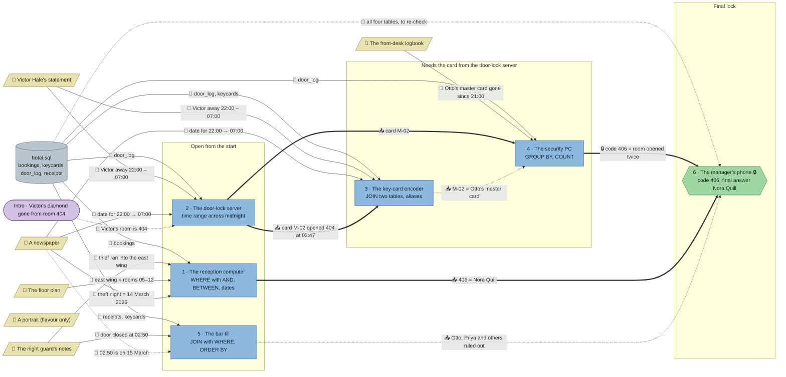

# The Blue Index: flow

What a team has to carry from where to where in `sql-hotel`. Hand-maintained with the `room-flow` skill; update it when the room's puzzles, clues, reveals or locks change. Values and solutions: [the walkthrough](../walkthroughs/sql-hotel.en.md).

| Arrow | Meaning |
|---|---|
| `==>` thick | A result or lock code moves from one station to another |
| `-->` solid | A clue or data file the station can't be solved without |
| `-.->` dotted | Context only: the value is also in the data or another clue, or it only helps to judge a result that isn't checked |

All six stations load the same `hotel.sql`, so the room has one data node; the edges name the tables each station needs. The room has no `requires`: the phone is behind a code lock, and the encoder and security PC need the card id from the door-lock server (`uses`).

## Phases

- **Start:** 3 stations can be solved at once (reception, door-lock server, bar till), and reception needs three clues from three corners of the room. Enough for a team of 3; in a team of 5 the others fetch clues.
- **Second wave:** the key-card encoder and the security PC are open, but their tasks name "the card that opened room 404 in the middle of the night", which only the door-lock server's result gives. The door-lock server is a short station (about 4 minutes), so the room is about 3 wide, then 4–5.
- **Final:** the phone opens with the code 406 from the security PC, then needs one name from the reception list.

## Chains

- Door-lock server → key-card encoder → security PC → phone: 4 stations, the longest path (the encoder link is soft, see below).
- Door-lock server → security PC → phone: 3 stations, the decisive path for the code.
- Reception → phone: 2 stations, needed for the name.
- Bar till → phone: 2 stations, context (rules out Otto, the card's owner and obvious suspect).

## Hand-offs

- Between stations: 6 edges. Hard: card M-02 into the encoder and the security PC, the lock code 406, and 406 = Nora Quill. Soft: the encoder's "M-02 is Otto's master card" for the security PC (the PC can also look it up in `keycards`), and the bar till's alibis for the phone.
- From clues: 10 clue edges from 5 clues, 9 of them hard. The newspaper feeds four stations (the date), the guard's notes two (the wing for reception, the time for the bar till), Victor's statement two, the floor plan and the logbook one each. The portrait stays flavour.

## Where things are

The room is a hotel ground floor: the marble lobby with the reception counter and the lift (right, with the exit and spawn), the staff back office (top left, through an opening behind the counter) and the bar with its card room (bottom left, through an arch from the lobby and a doorway from the office).

- The guard's notes, on his stand by the lift (704, 64), are about 200 px from reception, which needs them, and 660 px from the bar till, which needs their time.
- The newspaper in the lounge (512, 384) is 256 px from reception, 370–450 px from the door-lock server and encoder, and 384 px from the bar till.
- The logbook on the reception counter (544, 128) is about 300 px from the security PC in the back office that needs it; Victor's statement on the card table where he played all night (320, 448) is about 380–400 px from the door-lock server and encoder.
- The floor plan on the back-office wall (96, 32) is about 430 px from reception.

## Findings

Fixed in this round (from the previous version of this page):

- The key-card encoder's `requires` became `uses: ["door-log"]`: it now follows the card that opened 404 (M-02, from the door-lock reveal) through the night, with its holder, so it is no longer station 2 plus a `JOIN`.
- The logbook no longer names M-02 ("my master card", plus a spare card), so the security PC needs the card from the door-lock server; its `requires` became `uses`.
- The phone's five `requires` became a code lock: code 406 from the security PC's reveal.
- The bar till's time window is no longer in the task text: it comes from the guard's notes (02:50, ± 10 minutes). Data: Henrik's 02:58 receipt moved to 03:02, so the window keeps the same four alibis.
- Reception now asks for the wing where the guard heard the thief, so the guard's notes and the floor plan (05–12 = east wing) are hard; 401–412 or 400–499 give the wrong rows.
- Clue lists now name the newspaper for the door-lock server, encoder and bar till.
- Data fix: Otto's 02:45 reception receipt was signed with the stolen card M-02, which contradicted his alibi. It is now signed with his spare card M-03.

Left as they are:

- **The encoder and the bar till are not needed to escape.** Their results only explain the case (M-02 is Otto's; Otto and Priya have alibis). A team that skips them can still open the phone and name Nora; the debrief shows the skipped stations. Making them hard for the final would need a new twist (e.g. two guests in room 406), more than the fix asked for.
- **The encoder's table already shows 406 at 02:52**, so a sharp team could guess the phone code before the security PC; the "twice" still comes from the PC.
- **Every station shares one database**, so a team could re-derive M-02 at any station by repeating the door-lock query; the hand-off saves that work rather than making it impossible.
- **The portrait is flavour only**, by design.
