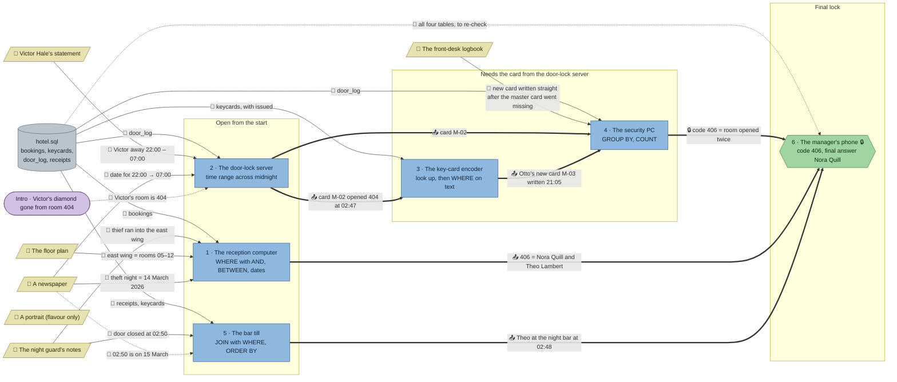

# The Blue Index: flow

What a team has to carry from where to where in `sql-hotel`. Hand-maintained with the `room-flow` skill; update it when the room's puzzles, clues, reveals or locks change. Values and solutions: [the walkthrough](../walkthroughs/sql-hotel.en.md).

| Arrow | Meaning |
|---|---|
| `==>` thick | A result or lock code moves from one station to another |
| `-->` solid | A clue or data file the station can't be solved without |
| `-.->` dotted | Context only: the value is also in the data or another clue, or it only helps to judge a result that isn't checked |

All six stations load the same `hotel.sql`, so the room has one data node; the edges name the tables each station needs. The room has no `requires`: the phone is behind a code lock, and the encoder and security PC need the card id from the door-lock server (`uses`).

## Phases

- **Start:** 3 stations can be solved at once (reception, door-lock server, bar till), and reception needs three clues from three corners of the room. Enough for a team of 3; in a team of 5 the others fetch clues.
- **Second wave:** the key-card encoder and the security PC are open, but their tasks name "the card that opened room 404 in the middle of the night", which only the door-lock server's result gives. The security PC also needs the encoder's 21:05, so the second wave is a short chain (encoder, then PC) next to the reception and bar till work. The door-lock server and encoder are short stations (about 4 minutes each), so the room is about 3 wide, then 4.
- **Final:** the phone opens with the code 406 from the security PC. The reception list shows two guests in 406, and the bar till rules out Theo, so the name needs both.

## Chains

- Door-lock server → key-card encoder → security PC → phone: 4 stations, the longest path and the decisive one for the code.
- Reception → phone: 2 stations, needed for the name.
- Bar till → phone: 2 stations, needed for the name (Theo has an alibi; it also clears Otto, the card's owner).

## Hand-offs

- Between stations: 6 edges. All hard: card M-02 into the encoder and the security PC, the encoder's 21:05 into the security PC, the lock code 406, the two guests of 406, and Theo's alibi.
- From clues: 7 clue edges from 5 clues, 6 of them hard. The newspaper feeds three stations (the date), the guard's notes two (the wing for reception, the time for the bar till), Victor's statement, the floor plan and the logbook one each. The encoder needs no clue. The portrait stays flavour.

## Where things are

The room is a hotel ground floor: the marble lobby with the reception counter and the lift (right, with the exit and spawn), the staff back office (top left, through an opening behind the counter) and the bar with its card room (bottom left, through an arch from the lobby and a doorway from the office).

- The guard's notes, on his stand by the lift (704, 64), are about 200 px from reception, which needs them, and 660 px from the bar till, which needs their time.
- The newspaper in the lounge (512, 384) is 256 px from reception, 370–450 px from the door-lock server and encoder, and 384 px from the bar till.
- The logbook on the reception counter (544, 128) is about 300 px from the security PC in the back office that needs it; Victor's statement on the card table where he played all night (320, 448) is about 380–400 px from the door-lock server.
- The floor plan on the back-office wall (96, 32) is about 430 px from reception.

## Findings

Fixed in the fifth review (the door-lock server no longer leads straight to the thief):

- **No door event after the theft points at 406 any more.** M-02 used to open 406 at 02:52, five minutes after 404, so the door-lock server's card and the guard's 02:50 were enough to find the room with one query around 02:50, and the encoder and security PC added nothing. That opening moved to 21:48: the thief tried the stolen card on their own door twice in the evening (21:20, 21:48) and came back after the theft through a door left on the latch.
- So only the security PC's window, which starts when Otto lost the card (21:05, from the encoder), finds 406. From 22:00 (Victor away) or 23:00 (the logbook entry) M-02 opened only 404; with no window, 404 and 406 tie among seven rooms. The security PC's result and every hash stayed the same.

Fixed in the fourth review (the bar till is needed to escape):

- **Room 406 has a second guest, Theo Lambert** (booking 18, card C-406B), so the code 406 points at two people. Theo signed a receipt at the night bar at 02:48, inside the bar till's window, so only Nora is left. The phone's `uses` now names the bar till.
- Reception now sorts by room, then by name (`ORDER BY room, guest_name`), because its check is ordered and 406 has two rows.

Fixed in the third review (each station of the card chain adds one piece the security PC needs):

- **The encoder no longer shows where the card went.** It used to list every M-02 event of the night with its holder: the door-lock server's query plus a `JOIN`, and its table already showed 404 at 02:47 and then 406 at 02:52, the phone code. Now it looks the card up in `keycards` and lists every card of its holder by the new `issued` column: Otto's new card M-03, written at 21:05.
- **The logbook no longer gives a time.** Otto writes at 23:00 that the master card went missing "earlier tonight" and that he had a new one written straight away. So the start of the security PC's window (21:05) only comes from the encoder, and the logbook says how to read it.
- **The security PC's check fails for every wrong window:** no filter gives 404 and 406 twice each, from 22:00 (Victor away) or 23:00 (the logbook entry) once each; only a start between 20:11 and 21:20 gives 406 twice, 404 once. Its result and hash did not change.
- The encoder no longer practises `JOIN`; the bar till still does.

Fixed in the second review (every clue once, no pointers to clues outside the hints, a clear goal per station):

- **No task names its clues any more.** Reception's task no longer says the night guard heard the thief run into a wing of the 4th floor (it asks for "the wing the thief ran off into"), and the bar till's no longer says the night guard noted when a door closed (it asks who was somewhere else when the thief got away upstairs). Where to look stays in each puzzle's first hint.
- **Every station says what it finds out**, in one sentence near the top: who came to room 404 while Victor was away (door-lock server), whose card it is and where else it went (encoder), which rooms it kept opening after it went missing (security PC), who was somewhere else (bar till).
- Nothing the checks compare changed; the starters only show `SELECT * … LIMIT 5`.

Fixed in the first review:

- The key-card encoder's `requires` became `uses: ["door-log"]`: it now follows the card that opened 404 (M-02, from the door-lock reveal) through the night, with its holder, so it is no longer station 2 plus a `JOIN`.
- The logbook no longer names M-02 ("my master card", plus a spare card), so the security PC needs the card from the door-lock server; its `requires` became `uses`.
- The phone's five `requires` became a code lock: code 406 from the security PC's reveal.
- The bar till's time window is no longer in the task text: it comes from the guard's notes (02:50, ± 10 minutes). Data: Henrik's 02:58 receipt moved to 03:02, so the window keeps the same four alibis.
- Reception now asks for the wing where the guard heard the thief, so the guard's notes and the floor plan (05–12 = east wing) are hard; 401–412 or 400–499 give the wrong rows.
- Clue lists now name the newspaper for the door-lock server, encoder and bar till.
- Data fix: Otto's 02:45 reception receipt was signed with the stolen card M-02, which contradicted his alibi. It is now signed with his spare card M-03.

Left as they are:

- **A team that skips the bar till could still guess between Nora and Theo** at the phone. The answer box doesn't limit tries; the debrief shows the skipped station.
- **Every station shares one database**, so a team could re-derive M-02 at any station by repeating the door-lock query; the hand-off saves that work rather than making it impossible.
- **The portrait is flavour only**, by design.
