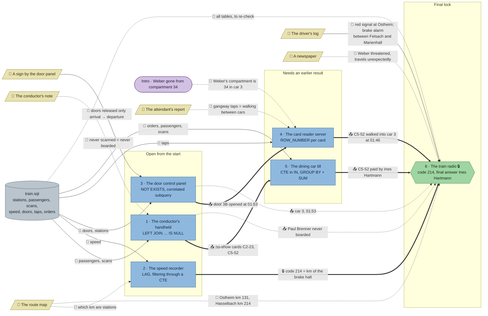

# Night Train: flow

What a team has to carry from where to where in `sql-train`. Hand-maintained with the `room-flow` skill; update it when the room's puzzles, clues, reveals or locks change. Values and solutions: [the walkthrough](../walkthroughs/sql-train.en.md).

| Arrow | Meaning |
|---|---|
| `==>` thick | A result or lock code moves from one station to another |
| `-->` solid | A clue or data file the station can't be solved without |
| `-.->` dotted | Context only: the value is also in the task text or the data, or it only helps to judge a result that isn't checked |

All six stations load the same `train.sql`, so the room has one data node; the edges name the tables each station needs. The room has no `requires`: the radio is behind a code lock, and the card reader server and the till need results from the door panel and the handheld (`uses`).

## Phases

- **Start:** 3 stations at once (handheld, speed recorder, door panel), each about 4–6 minutes. Enough for a team of 3; in a team of 4–5 the others read the clues and the handbook, which matters more here than in the beginner rooms (window functions are new to most).
- **Second wave:** the card reader server needs the door time (01:53), the till needs the two no-show cards. Both open as soon as the door panel and the handheld are solved, so the room stays about 3 wide, then 2.
- **Final:** the radio opens with 214 (speed recorder + driver's log), then needs a name that only cards + till give together.

## Chains

- Door panel → card reader server → radio: 3 stations, the longest path for the name.
- Handheld → till → radio: 3 stations, the other half of the name.
- Speed recorder → radio: 2 stations, the lock code.

## Hand-offs

- Between stations: 7 edges, 5 hard (door time, no-show cards, lock code, C5-52 into car 3, C5-52's payer) and 2 soft (Brenner never boarded, which rules out the booked name; car 3 at 01:53).
- From clues: 8 clue edges from 6 clues, 2 of them hard (the door sign's release rule, the driver's log that tells the brake halt from the red signal).

## Where things are

The room is three carriages side by side, joined by gangways over the track: the service car at the bottom (where the team boards, with the exit, the speed recorder, door panel, card reader server and radio), the dining car in the middle (counter with the handheld and the till, booths), reached by a gangway at its left end, and the sleeping car at the top (compartment 34), reached by a gangway at the dining car's right end.

- The driver's log (704, 544) lies on the desk next to the radio (672, 544).
- The door sign (416, 512) hangs on the wall right above the door panel (384, 544), and the route map (256, 512) beside the speed recorder (224, 544).
- The conductor's note (160, 320) is on the dining-car counter next to the handheld (128, 320).
- The attendant's report on compartment 34's door (576, 32) is two carriages away from the card reader server (512, 544): through both gangways, the longest walk in the room.

## Findings

- **The handheld and the till have no hard clue.** The handheld's rule ("never scanned = never boarded") is in the task text too; the till only needs the handheld's result. For an advanced room the SQL carries these stations, which seems right, but a playtest should show whether the conductor's note gets read at all.
- **The attendant's report is soft:** it explains why a gangway tap means walking into the next car, which a team needs to read the card reader result, but the check passes without it.
- **The trap in the final:** `C5-52` belongs to Paul Brenner's booking, so a team that skips the handheld or the till will likely answer "Paul Brenner". The handheld says he never boarded; the till names Ines Hartmann.
- **The lock can't be guessed from the clues alone:** the route map lists five kilometre posts between Felsach and Marienhall, so 214 needs the speed recorder.
- **Every station shares one database**, so the card reader server could re-derive 01:53 by repeating the door query, and the till could redo the anti-join; the hand-offs save work rather than make it impossible. The till's hint suggests reusing the handheld's query as a CTE on purpose.
- **The newspaper is flavour** (Weber's motive), by design.
