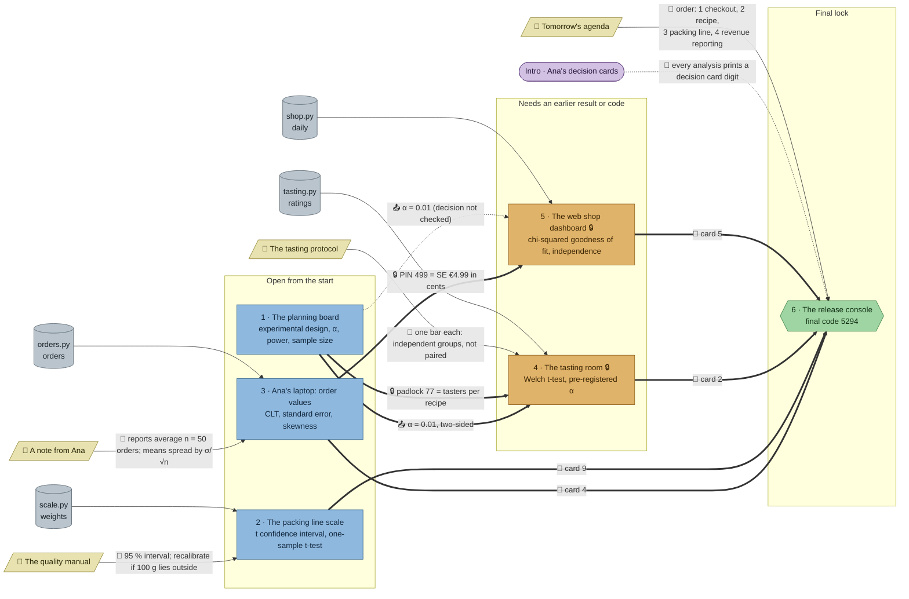

# The Chocolate Experiment: flow

What a team has to carry from where to where in `stats-ab`. Hand-maintained with the `room-flow` skill; update it when the room's puzzles, clues, reveals or locks change. Values and solutions: [the walkthrough](../walkthroughs/stats-ab.en.md).

| Arrow | Meaning |
|---|---|
| `==>` thick | A result, lock code or final digit moves from one station to another |
| `-->` solid | A clue or data file the station can't be solved without |
| `-.->` dotted | Context only: the value is also in the task text, or it only helps to judge a result that isn't checked |

## Phases

- **Start:** 3 stations open at once (planning board, packing line scale, Ana's laptop). Each needs a clue from the wall, so a team of 4–5 has people reading and walking, not waiting.
- **Second wave:** 2 stations. The tasting room opens with the fridge padlock (77, from the planning board) and decides at the plan's α = 0.01. The web shop dashboard opens with the PIN 499 (the standard error €4.99 from Ana's laptop). The packing line has no follow-up, so whoever solves it moves to the console or helps one of the two.
- **Final:** the console needs all four decision card digits and the agenda's order.

## Chains

- Planning board → tasting room → console, and Ana's laptop → dashboard → console: 3 stations each.
- Packing line → console: 2 stations.
- Two equal chains instead of one bottleneck: the planning board and Ana's laptop should both be opened early.

## Hand-offs

- Between stations: 3 hard (padlock code 77 and α = 0.01 two-sided from the plan to the tasting room; PIN 499 from Ana's laptop to the dashboard) and 1 soft (α to the dashboard), plus 4 card digits into the console.
- From clues: 4 clues, all hard: the quality manual (the 95 % level), Ana's note (the sample size 50 and σ/√n), the tasting protocol (independent, not paired) and the agenda.

## Where things are

The factory has four parts: the marble foyer with the exit, the release console and Ana's binder (where the team arrives), the blind-tasting room off the foyer, the long packing hall below, and Ana's office, reached only through the hall.

- Next to its station: the tasting protocol, on an easel at the tasting room's door, 6 tiles from the fridge.
- On the wall right above their stations: Ana's note (2 tiles above Ana's laptop, in the office) and the quality manual (3 tiles above the packing line scale, in the hall).
- Ana's laptop and the dashboard stand 5 tiles apart in the same office, so the PIN is a short hand-off.
- The agenda hangs in Ana's office; the console stands by the exit in the foyer, a walk through the packing hall away.
- The planning board hangs in the office's north-west corner; the tasting room's fridge is reached from the foyer, about 20 tiles of walking through the hall: the hand-off that makes the team walk and talk.

## Findings

Fixed in this round: the quality manual's level, Ana's note's sample size and the tasting protocol's "independent" are no longer in the task texts or starters; the dashboard sits behind a PIN from Ana's laptop instead of a soft `uses: plan`; the plan's reveal now limits α = 0.01 to the two experiments, and a 99 % interval at the packing line gets a message pointing to the manual; a paired t-test in the tasting room gets its own message.

Left on purpose:

- **The dashboard's α is still context only.** Step 3 asks whether the difference is significant at the registered level, but with p = 0.00024 the answer is the same at 0.01 and 0.05, and it isn't checked. Making it matter would mean regenerating the data so p lands between 0.01 and 0.05, which turns the checkout into a second "not significant" story next to the recipe. The tasting room already teaches that lesson.
- **The manual's decision rule is still weak.** The confidence level is now needed, but `recalibrate` comes out True under any sensible rule (p = 0.0017). The manual is hard through the level, which is enough.
- **Student's t-test passes in the tasting room.** With 77 tasters per group it gives the same p as Welch's (0.0252), so "without assuming equal spreads" isn't enforced. The distinction the protocol carries (independent vs. paired) is.
