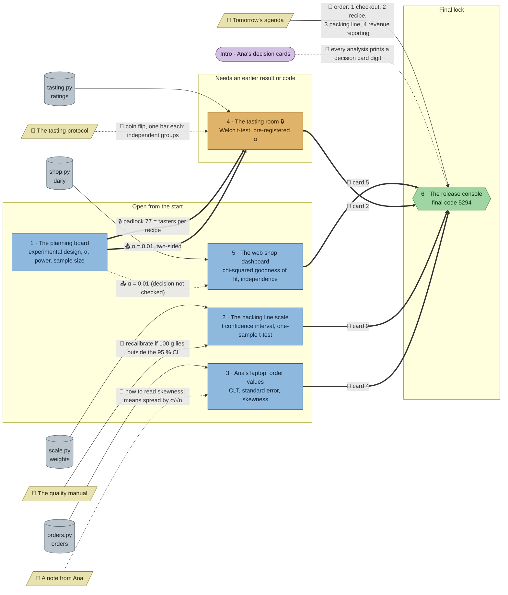

# The Chocolate Experiment: flow

What a team has to carry from where to where in `stats-ab`. Hand-maintained with the `room-flow` skill; update it when the room's puzzles, clues, reveals or locks change. Values and solutions: [the walkthrough](../walkthroughs/stats-ab.en.md).

| Arrow | Meaning |
|---|---|
| `==>` thick | A result, lock code or final digit moves from one station to another |
| `-->` solid | A clue or data file the station can't be solved without |
| `-.->` dotted | Context only: the value is also in the task text, or it only helps to judge a result that isn't checked |

## Phases

- **Start:** 4 stations open at once (planning board, packing line scale, Ana's laptop, web shop dashboard). The dashboard lists the planning board in `uses`, but `uses` isn't enforced and its check needs nothing from the plan, so it is effectively open. Enough for a team of 4; a team of 5 has one person reading clues.
- **Second wave:** only the tasting room, behind the fridge padlock (77 from the planning board), and its decision needs the plan's α = 0.01. Parallel width drops from 4 to 1: whoever isn't on the tasting room is waiting for the console.
- **Final:** the console needs all four decision card digits and the agenda's order.

## Chains

- Planning board → tasting room → console: 3 stations, the only long chain.
- Packing line → console, Ana's laptop → console, dashboard → console: 2 stations each.
- The planning board is the bottleneck: the tasting room can't start until it's solved, so it should be the first station someone opens.

## Hand-offs

- Between stations: 2 hard (padlock code 77, α = 0.01 two-sided, both from the plan to the tasting room) and 1 soft (α to the dashboard), plus 4 card digits into the console.
- From clues: 4 clues; 2 hard (the quality manual, though weakly, and the agenda), 2 soft (Ana's note, the tasting protocol).

## Where things are

- Next to its station: the tasting protocol (2 tiles from the tasting room).
- On the north wall, about 4–5 tiles above their stations: the quality manual (packing line scale) and Ana's note (Ana's laptop). Close enough to read in passing.
- The agenda hangs on the north wall directly above the console, 8 tiles away.
- The planning board stands in the north-west corner, about 10 tiles from the tasting room in the south: the one hand-off that makes the team walk and talk.

## Findings

- **The dashboard's `uses: plan` is soft.** The check takes `srm_p`, `chi2`, `p_value` and `winner`; "is the difference significant at the registered level?" isn't checked, and with p = 0.00024 the answer is the same at 0.01 and 0.05. Checking a decision wouldn't help unless the data put p between 0.01 and 0.05 (as the tasting does).
- **The quality manual is hard only in name.** `recalibrate` must be True, and every reasonable rule gives True (p = 0.0017 is below both 0.05 and the plan's 0.01), so a team passes without reading the manual. Its decision rule only becomes needed if the interval and a naive rule disagree.
- **Two soft clues.** Ana's note: the task text already names `scipy.stats.skew` and σ/√n, and how to read skewness isn't checked. The tasting protocol: the task already says "independent groups (Welch's version)".
- **Ana's laptop needs nothing from elsewhere in the room** (its only clue is soft), and neither does the packing line in practice. With the planning board as the room's source, three of the five analyses can be solved without leaving the station.
- **Two significance levels in one room.** The plan's reveal says α = 0.01 "for every experiment of the relaunch", while the quality manual asks for a 95 % interval. A team that carries α = 0.01 to the packing line and builds a 99 % interval gets the generic "The confidence interval is off" message, not a pointer to the manual.
- **Only one station unlocks later,** so the second wave is one station wide. Making the dashboard's task really need a value from another station (or locking it) would keep a second sub-team busy after the first wave.
