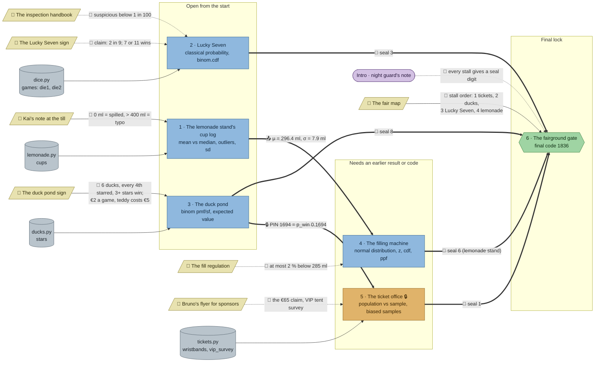

# The Rigged Fair: flow

What a team has to carry from where to where in `stats-fair`. Hand-maintained with the `room-flow` skill; update it when the room's puzzles, clues, reveals or locks change. Values and solutions: [the walkthrough](../walkthroughs/stats-fair.en.md).

| Arrow | Meaning |
|---|---|
| `==>` thick | A result, lock code or final digit moves from one station to another |
| `-->` solid | A clue or data file the station can't be solved without |
| `-.->` dotted | Context only: the value is also in the task text, or it only helps to judge a result that isn't checked |

## Phases

- **Start:** 3 stations open at once (lemonade, Lucky Seven, duck pond). Enough for a team of 3; a team of 5 pairs up.
- **Second wave:** the filling machine has no data of its own and needs the cup log's μ and σ; the ticket office laptop needs the PIN from the duck pond's reveal. Both open as soon as the first wave's stations are done, so a team that splits well finishes the first wave and the second wave in two parallel lanes.
- **Final:** the gate needs all four seals and the fair map.

## Chains

- Lemonade → filling machine → gate and duck pond → ticket office → gate: 3 stations each, the longest paths.
- Lucky Seven → gate: 2 stations.
- The two long chains don't share a station, so two sub-teams can each take one.

## Hand-offs

- Between stations: 2 (μ/σ, the PIN), plus 4 seal digits into the gate.
- From clues: 7 clues; 3 hard (Kai's note, the duck pond sign, the fair map), 4 soft.

## Where things are

- Next to their station: Kai's note (lemonade), the duck pond sign, the Lucky Seven sign, Bruno's flyer (ticket office).
- On the north wall, away from their stations: the inspection handbook, the fill regulation and the fair map (the map hangs at the opposite end from the gate). The filling machine stands in the south row, the fill regulation on the north wall.

## Findings

- **Three of the four soft clues carry nothing the check needs.** The Lucky Seven task text names "7 or 11", the filling machine's task names 285 ml and 2 %, and the ticket office task already says the VIP survey is the flyer's source. The fill regulation and the flyer could become hard by taking 285 ml / 2 % (or the €65 figure) out of the task text.
- **The handbook's 1-in-100 rule is never checked.** The dice check takes `p_value` but not a verdict. A `rigged = True/False` variable in the check would make the handbook needed.
- **Lucky Seven needs nothing from elsewhere in the room** (all its clues are soft). With several lines of code it still meets the rooms.md rule, but it's the one station a solo player can finish without walking.
- **The lemonade station gives no seal itself;** its seal comes from the filling machine. The fair map calls stall 4 "Lemonade stand", which matches, but teams may look for a seal in the cup log's reveal first. Hint 1 of the gate lists which stations give seals.
