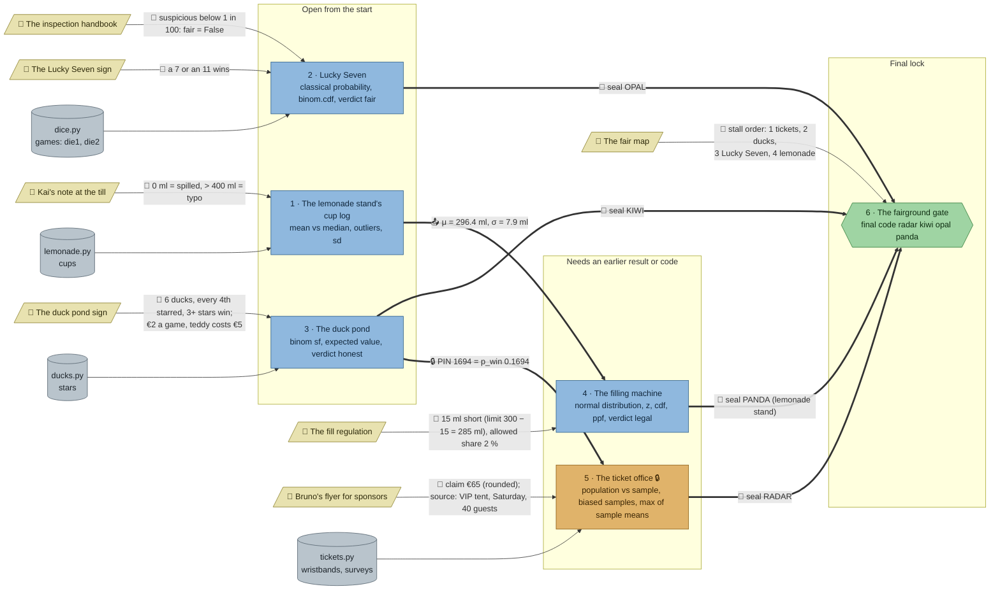

# The Rigged Fair: flow

What a team has to carry from where to where in `stats-fair`. Hand-maintained with the `room-flow` skill; update it when the room's puzzles, clues, reveals or locks change. Values and solutions: [the walkthrough](../walkthroughs/stats-fair.en.md).

| Arrow | Meaning |
|---|---|
| `==>` thick | A result, lock code or seal word moves from one station to another |
| `-->` solid | A clue or data file the station can't be solved without |
| `-.->` dotted | Context only: the value is also in the task text, or it only helps to judge a result that isn't checked |

## Phases

- **Start:** 3 stations open at once (lemonade, Lucky Seven, duck pond). Enough for a team of 3; a team of 5 pairs up.
- **Second wave:** the filling machine has no data of its own and needs the cup log's μ and σ plus the fill regulation's limit and share; the ticket office laptop needs the PIN from the duck pond's reveal. Both open as soon as the first wave's stations are done, so a team that splits well finishes the first wave and the second wave in two parallel lanes.
- **Final:** the gate needs all four seals and the fair map.

## Chains

- Lemonade → filling machine → gate and duck pond → ticket office → gate: 3 stations each, the longest paths.
- Lucky Seven → gate: 2 stations.
- The two long chains don't share a station, so two sub-teams can each take one.

## Hand-offs

- Between stations: 2 (μ/σ, the PIN), plus 4 seal words into the gate.
- From clues: 7 clues, all hard. The gate's task is the only place that explains the seals; the intro no longer repeats it.

## Where things are

- Players arrive on the cobbled plaza by the gate (east), with the gate's keypad and the pocket guide. The ticket office stands at the top of the plaza; the duck pond and Lucky Seven line the sawdust midway along the north hoarding; the carousel and high striker are in the middle; the lemonade stand and the filling machine are in the food court in the south-west.
- Next to their station: Kai's note (two tiles from the lemonade stand), the duck pond sign, the Lucky Seven sign, Bruno's flyer (ticket office).
- On the north hoarding, away from their stations: the inspection handbook (above the midway, between the two games), the fill regulation (towards the plaza) and the fair map (at the west end, the opposite end from the gate). The filling machine stands in the south-west, the fill regulation on the north wall. So Lucky Seven, the filling machine and the gate each need a walk to the north wall.

## Findings

Fixed in step 23 (the gate can't be brute-forced):

- **The seals are code words, not digits.** The gate's code was one digit per stall, so a team with three seals could try the ten values for the fourth and skip a station (most likely the lemonade stand and the filling machine). Each seal is now a word, spelled the same in English and German and unrelated to the others (ticket office RADAR, duck pond KIWI, Lucky Seven OPAL, lemonade stand PANDA), and the gate wants all four in stall order with spaces: `radar kiwi opal panda`. A missing word can't be guessed. Answers ignore case and extra spaces, but other separators (commas) count as wrong: the night guard's note asks for spaces.

Fixed in the shortcut review:

- **`flyer_mean = 65` passed.** The flyer clue states the number and the survey averaged exactly €65.00, so the filtering step could be skipped. The VIP-tent Saturday survey now averages €64.675 (its largest spend went from 101 to 88; `generate_data.py` targets a sum of 2587), the flyer's €65 is a rounding, and the check names a typed 65 ("the number printed on the flyer").
- **The Lucky Seven sign no longer says "2 in 9".** That was `p_theory` word for word (8/36), so the 36-outcome count could be skipped. The sign now only says which sums win; the hints still carry 8 / 36.
- **The cup log's `clean` was only checked for its length (116),** so any 116 values passed. It now has to hold exactly the cups above 0 ml and up to 400 ml.
- Tried and failed as intended: all four surveys averaged, the wrong survey, `clean` dropping the wrong four cups. Tried and fine: `clean` built by sorting and slicing, or with a looser upper bound (same reasoning as the station teaches).
- **Left:** the `means` check only tests plausibility (mean and spread), so means drawn from a normal distribution instead of `wristbands.sample` pass; a bigger fix would pass the team's code a second input. The duck pond's and the filling machine's numbers can't be read off anything before the station is solved, so the tolerances stay.

Fixed in the second review (every clue once, no pointers to clues outside the hints, a clear goal per station):

- **No task names its clues any more.** The gate's task no longer mentions the fair map, the duck pond's no longer says the sign has the rules, the cup log's no longer mentions Kai's note, the filling machine's no longer says its values come from the cup log and the regulation, and no starter comment or check message says "see the sign". Where to look is now in each puzzle's first hint.
- **The seal rule is only on the gate.** The intro no longer repeats the night guard's note.
- **The fill regulation no longer works out 285 ml for the team;** they subtract the 15 ml themselves.
- **Every station ends in a verdict:** `mean_moved`/`median_moved` (cup log), `fair` (Lucky Seven, replacing `threshold` and `rigged`), `honest` (duck pond, which used to end in an optional commented-out chart), `legal` (filling machine) and `could_be_luck` (ticket office, from `max_mean`, the largest of 1,000 random sample means).
- **The flyer's €65 is the survey rounded:** the VIP-tent Saturday survey averages €64.675 (see the shortcut review above). The fixed-seed `sample(40, random_state=7)` step is gone.
- **Lucky Seven's starter no longer builds the 36 outcomes;** the team lists them with `itertools.product`.

Fixed (the first review):

- **Soft clues made hard.** Lucky Seven's task no longer names the winning sums (the sign does); the filling machine's task and starter no longer name 285 ml or 2 % (new `limit` and `allowed` variables, values only on the fill regulation); the check's error messages no longer leak them either.
- **The flyer is needed.** The laptop now holds four surveys (`surveys` with `place`, `day`, `spent`: VIP tent Saturday and Friday, main entrance, beer garden); only the flyer's small print (VIP tent, Saturday, 40 guests) says which one to average as `flyer_mean`. The check names it when a team picks a wrong survey or averages them all.
- **The handbook's rule is checked.** Lucky Seven now asks for `threshold` (0.01, from the handbook) and the verdict `rigged`.
- **Lucky Seven needs something from elsewhere:** the handbook on the north wall.
- **The cup log's reveal says** its seal comes from the filling machine.

Left as they are:

- **Lucky Seven and the duck pond get nothing from other stations,** only from clues. With two lanes of three stations already chained, a third chain would push the room past 30 minutes.
