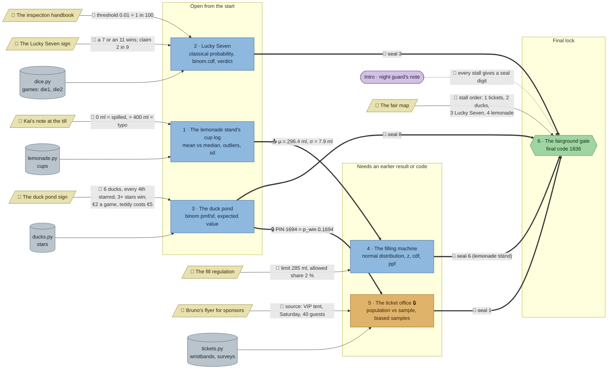

# The Rigged Fair: flow

What a team has to carry from where to where in `stats-fair`. Hand-maintained with the `room-flow` skill; update it when the room's puzzles, clues, reveals or locks change. Values and solutions: [the walkthrough](../walkthroughs/stats-fair.en.md).

| Arrow | Meaning |
|---|---|
| `==>` thick | A result, lock code or final digit moves from one station to another |
| `-->` solid | A clue or data file the station can't be solved without |
| `-.->` dotted | Context only: the value is also in the task text, or it only helps to judge a result that isn't checked |

## Phases

- **Start:** 3 stations open at once (lemonade, Lucky Seven, duck pond). Enough for a team of 3; a team of 5 pairs up.
- **Second wave:** the filling machine has no data of its own and needs the cup log's μ and σ plus the fill regulation's limit and share; the ticket office laptop needs the PIN from the duck pond's reveal. Both open as soon as the first wave's stations are done, so a team that splits well finishes the first wave and the second wave in two parallel lanes.
- **Final:** the gate needs all four seals and the fair map.

## Chains

- Lemonade → filling machine → gate and duck pond → ticket office → gate: 3 stations each, the longest paths.
- Lucky Seven → gate: 2 stations.
- The two long chains don't share a station, so two sub-teams can each take one.

## Hand-offs

- Between stations: 2 (μ/σ, the PIN), plus 4 seal digits into the gate.
- From clues: 7 clues, all hard. Only the intro's "every stall gives a seal digit" is context (the gate's task repeats it).

## Where things are

- Next to their station: Kai's note (lemonade), the duck pond sign, the Lucky Seven sign, Bruno's flyer (ticket office).
- On the north wall, away from their stations: the inspection handbook, the fill regulation and the fair map (the map hangs at the opposite end from the gate). The filling machine stands in the south row, the fill regulation on the north wall. So Lucky Seven, the filling machine and the gate each need a walk to the north wall.

## Findings

Fixed (the earlier findings):

- **Soft clues made hard.** Lucky Seven's task no longer names the winning sums (the sign does); the filling machine's task and starter no longer name 285 ml or 2 % (new `limit` and `allowed` variables, values only on the fill regulation); the check's error messages no longer leak them either.
- **The flyer is needed.** The laptop now holds four surveys (`surveys` with `place`, `day`, `spent`: VIP tent Saturday and Friday, main entrance, beer garden); only the flyer's small print (VIP tent, Saturday, 40 guests) says which one to average as `flyer_mean`. The check names it when a team picks a wrong survey or averages them all.
- **The handbook's rule is checked.** Lucky Seven now asks for `threshold` (0.01, from the handbook) and the verdict `rigged`.
- **Lucky Seven needs something from elsewhere:** the handbook on the north wall.
- **The cup log's reveal says** its seal comes from the filling machine.

Left as they are:

- **The Lucky Seven sign's "2 in 9" is p_theory.** A team can copy it instead of counting outcomes; the check can't tell. It's the stall's claim the inspection tests, and the count of wins and the p-value still need the winning sums, so it stays.
- **Lucky Seven and the duck pond get nothing from other stations,** only from clues. With two lanes of three stations already chained, a third chain would push the room past 30 minutes.
