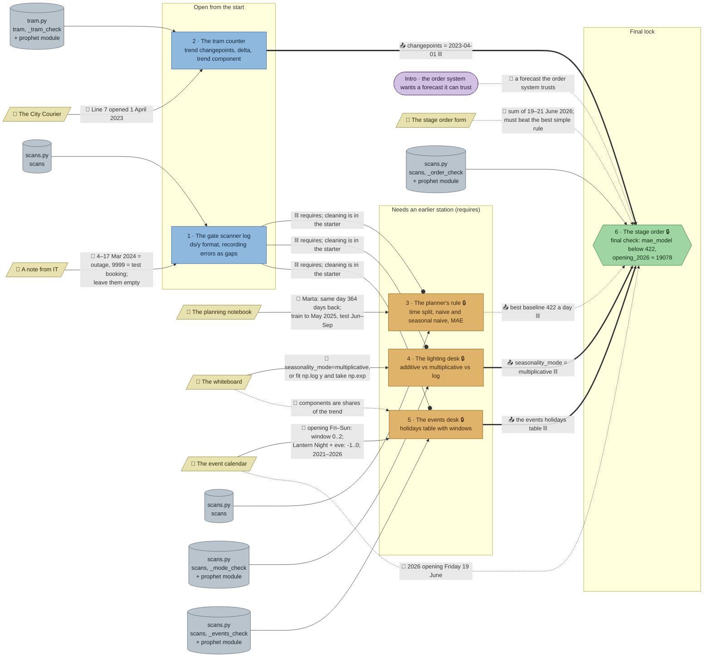

# Festival Season: flow

What a team has to carry from where to where in `ts-festival`. Hand-maintained with the `room-flow` skill; update it when the room's puzzles, clues, reveals or locks change. Values and solutions: [the walkthrough](../walkthroughs/ts-festival.en.md).

| Arrow | Meaning |
|---|---|
| `==>` thick | A result moves from one station to another |
| `-->` solid | A clue or data file the station can't be solved without |
| `--o` ⛓ | A `requires` lock: the station stays closed until the other is solved, but no knowledge moves |
| ⛓ at the end of a label | The target also `requires` the source |
| `-.->` dotted | Context only: the value is also in the task text or starter code, or the check doesn't need it |

🔒 here marks a station behind `requires`; the room has no code locks. "+ prophet module" means the station's starter imports `from prophet import Prophet`, the room module in `content/python/prophet.py` (declared in the manifest's `modules`).

## Phases

- **Start:** 2 stations open (gate scanner log, tram counter). A team of 2 fits exactly; in a team of 3–5 the rest have only clues to read.
- **Second wave:** the planner's rule, the lighting desk and the events desk all open once the gate is solved, and the tram counter may still be running: up to 4 stations at once, enough for a team of 4–5.
- **Final:** the stage order opens when the tram counter, planner, lighting desk and events desk are all solved.

## Chains

- Gate → planner / lighting desk / events desk → stage order: 3 stations, the longest paths (all three run through the gate, so the gate is the bottleneck early on).
- Tram counter → stage order: 2 stations.

## Hand-offs

- Between stations: 3 hard results into the stage order (changepoint, multiplicative mode, events table) and 1 soft one (the 422 baseline). Plus 7 `requires` edges, 3 of which (gate → 3, 4, 5) carry no knowledge at all.
- From clues: 6 clues; 5 hard (IT note, City Courier, planning notebook, whiteboard, event calendar), 1 soft (the stage order form). The whiteboard and the event calendar each have one more soft edge.

## Where things are

- Next to their station: the City Courier (tram counter), the planning notebook (planner), the stage order form (stage order), and, a few tiles away, the IT note (gate) and the event calendar (events desk).
- Away from its station: the whiteboard hangs on the north wall near the tram counter, while the lighting desk that needs it stands in the middle of the room.
- The event calendar also feeds the stage order (2026 dates), which stands at the opposite, south-east corner.

## Findings

- **The gate's `requires` are purely mechanical.** The planner, lighting desk, events desk and stage order starters all contain the gate's cleaning code ("The cleaned gate log from the scanner terminal"), so they hand out station 1's model solution and the lock only delays. Take the cleaning out of those starters and make them `uses: ["gate"]` (teams copy their own `df`), or put them behind a code lock whose code is in the gate's reveal (for example the 1714 counted days).
- **The stage order's `requires` on tram, mode and events could become `uses`:** the task already needs their results (`changepoints=["2023-04-01"]`, multiplicative, the events table), and the order check's messages ("multiplicative? the right changepoint?") tell teams what's missing.
- **The planner's 422 is never needed.** The order check enforces `mae_model < 422` and its rejection text states 422 itself, so the stage order needs nothing from the planner; that `requires` is mechanical too. Asking for the best baseline's error (or its name) in the stage order would turn it into a real `uses`.
- **The stage order form is soft:** the task text and the starter already say "all three days added up" and "forecast until 21 June 2026"; the calendar gives 19 June too.
- **The events desk leaks the lighting desk's answer:** its task and starter already use `seasonality_mode="multiplicative"`, and both open at the same time. The stage order can also rebuild `events` from the calendar without the events desk.
- **The whiteboard is the model's API reference for every Prophet station** but is listed only for the lighting desk; the tram counter's starter carries its own API notes.
- **The tram counter needs nothing from elsewhere** but the newspaper: the automatic `biggest_change` passes within 75 days of the opening, but `growth_before`/`growth_after` need the exact date.
