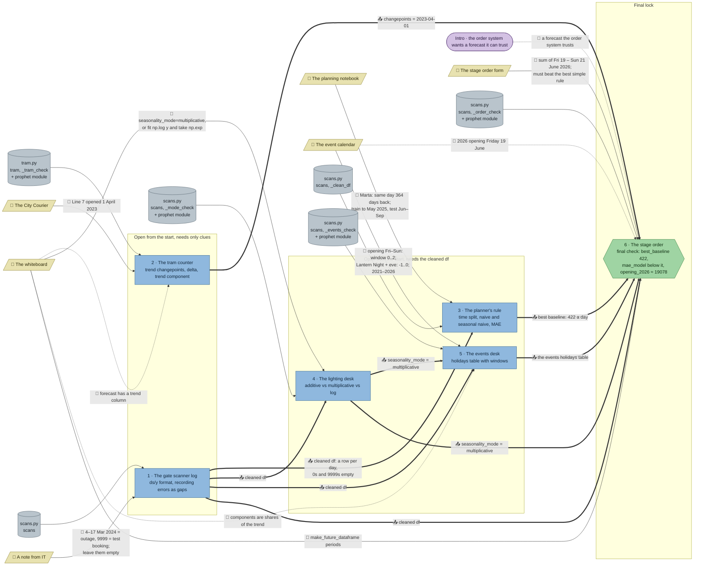

# Festival Season: flow

What a team has to carry from where to where in `ts-festival`. Hand-maintained with the `room-flow` skill; update it when the room's puzzles, clues, reveals or locks change. Values and solutions: [the walkthrough](../walkthroughs/ts-festival.en.md).

| Arrow | Meaning |
|---|---|
| `==>` thick | A result moves from one station to another |
| `-->` solid | A clue or data file the station can't be solved without |
| `-.->` dotted | Context only: the value is also in the task text or starter code, or the check doesn't need it |

The room has no `requires` and no code locks; every station is open from the start and every link is a `uses` or a clue. "+ prophet module" means the station's starter imports `from prophet import Prophet`, the room module in `content/python/prophet.py` (declared in the manifest's `modules`). The planner, lighting desk, events desk and stage order starters begin with `df = None`: teams copy their `df` from the gate scanner log, and every grader there checks it (1734 rows, 1714 counted days) before anything else.

## Phases

- **Start:** all 6 stations are open, but only the gate scanner log and the tram counter can be solved without another station's result. A team of 2 fits exactly; in a team of 3–5 the others can read the planning notebook, whiteboard and event calendar and start building the planner's forecasts and the `events` table while the gate is being cleaned.
- **Once the gate's `df` is in hand:** the planner's rule and the lighting desk can be finished, and the events desk once the lighting desk names the seasonality mode. With the tram counter still running that is up to 4 stations at once, enough for a team of 4–5.
- **Final:** the stage order needs the cleaned `df`, the changepoint (tram), the best baseline (planner), the seasonality mode (lighting desk) and the `events` table (events desk); its check names what is missing without giving values.

## Chains

- Gate → lighting desk → events desk → stage order: 4 stations, the longest path. Building the `events` table doesn't wait for the lighting desk; only the final fit does.
- Gate → planner's rule → stage order, gate → lighting desk → stage order: 3 stations.
- Tram counter → stage order: 2 stations.

## Hand-offs

- Between stations: 9 hard results. The cleaned `df` from the gate into 4 stations, the seasonality mode into the events desk, and into the stage order the changepoint, the 422 baseline, the mode and the `events` table.
- From clues: 6 clues, all hard for at least one station (IT note → gate, City Courier → tram, planning notebook → planner, whiteboard → lighting desk and stage order, event calendar → events desk, stage order form → stage order). Soft extras: the whiteboard for the tram counter and the events desk, the event calendar for the stage order.

## Where things are

- Next to their station: the City Courier (tram counter), the planning notebook (planner), the stage order form (stage order), and, a few tiles away, the IT note (gate) and the event calendar (events desk).
- Away from its station: the whiteboard hangs on the north wall near the tram counter, while the lighting desk and the stage order that need it stand in the middle and the south-east corner.
- The event calendar also gives the stage order the 2026 dates, from the opposite corner.

## Findings

Fixed (this revision):

- The gate's `requires` are gone. The four later starters no longer contain the gate's cleaning code; they start from `df = None`, list `uses: ["gate"]`, and their graders reject any `df` that isn't the cleaned log. The gate's task, last hint and check now insist on keeping a row for every day (the planner's `shift(364)` needs it), and its reveal says to take the code along.
- The stage order's `requires` on tram, lighting desk and events desk are now `uses`; its rejection texts name the stations to check instead of "multiplicative? the right changepoint?".
- The planner's 422 now travels: the stage order asks for `best_baseline` and checks it, and its rejection text no longer states 422.
- The stage order form is now hard: the task and starter only say "the figure the stage order form asks for"; which days and that they are summed are on the form (the last hint still gives it away).
- The events desk no longer leaks the lighting desk's answer: its task and starter ask for the mode that won at the lighting desk (`uses: ["gate", "mode"]`), and the check's rejection points there instead of naming `multiplicative`.
- The whiteboard is now listed for every Prophet station (tram counter, lighting desk, events desk, stage order); the stage order's starter doesn't mention `make_future_dataframe`, so it needs it.

Left on purpose:

- The stage order can rebuild `events` from the event calendar without the events desk. The windows have to be worked out from the calendar's wording either way, and the events desk is where its check explains them; forcing the hand-off would need a lock or an extra variable for little gain.
- The tram counter needs nothing from other stations, only the City Courier. It is one of the two stations that have to be open from the start.
- The whiteboard's "swings that grow with the level: multiplicative" hints at the lighting desk's winner; that is the clue the lighting desk is built on, and the desk still has to show it on the holdout.
- The gate is a bottleneck: four stations need its `df`. It is the shortest station, the tram counter runs alongside it, and the other stations' preparation (reading clues, writing forecasts and the `events` table) doesn't need it.
