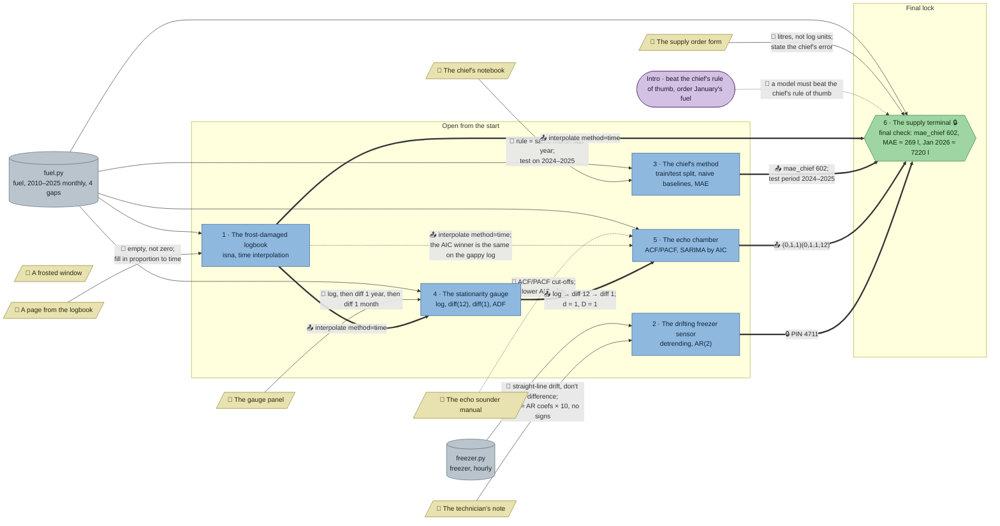

# Station Nordlys: flow

What a team has to carry from where to where in `ts-nordlys`. Hand-maintained with the `room-flow` skill; update it when the room's puzzles, clues, reveals or locks change. Values and solutions: [the walkthrough](../walkthroughs/ts-nordlys.en.md).

| Arrow | Meaning |
|---|---|
| `==>` thick | A result, lock code or final digit moves from one station to another |
| `-->` solid | A clue or data file the station can't be solved without |
| `-.->` dotted | Context only: the value is also in the task text or starter code, or it only helps to judge a result that isn't checked |

The room has no `requires` any more. The supply terminal is the `final` Python check and sits behind a code `lock` (PIN 4711 from the freezer's reveal). Its grader `_supply_check(mae_chief, mae_sarima, jan_2026)` in `fuel.py` wants the chief's 602 without stating it, and accepts only the airline model's numbers (holdout MAE within 10 l of 269, January within 15 l of 7220). The frosted window (aurora) is flavour and feeds no station.

## Phases

- **Start:** 5 stations open (logbook, freezer, chief's method, gauge, echo chamber). Logbook, freezer and chief's method need nothing from elsewhere; the gauge needs the logbook's fill, the echo chamber the gauge's transform, so those two teams find out they have to wait or ask.
- **Final:** the supply terminal opens with the freezer's PIN, and its check needs the chief's 602 and test period, the echo chamber's model and the logbook's fill.
- Parallel width: 3 stations solvable at once from the start (logbook, freezer, chief), 5 open; enough for a team of 3–5.

## Chains

- Logbook → gauge → echo chamber → supply terminal: 4 stations, the longest path.
- Chief's method → supply terminal; freezer → supply terminal: 2 stations each.

## Hand-offs

- Between stations: 7 edges, 6 hard (logbook → gauge, logbook → supply, gauge → echo, chief → supply, echo → supply, freezer PIN → supply lock), 1 soft (logbook → echo: SARIMAX copes with the gaps and picks the same winner).
- From clues: 7 clues; 5 hard (logbook page, technician's note, chief's notebook, gauge panel, order form), 1 soft (echo manual), 1 flavour (frosted window).

## Where things are

Tiles are 32 px; the map is 22 × 15 tiles.

- Next to their station (1 tile): the logbook page, the chief's notebook, the gauge panel.
- A short walk: the technician's note stands about 6 tiles from the freezer (north-west of it), the echo manual about 7 tiles from the echo chamber (north-east).
- Across the room: the order form hangs on the north wall, about 10 tiles from the supply terminal in the south-east.
- The stations that trade results are spread out: logbook (west) → gauge (north), gauge → echo chamber (south centre), chief (north-east) and echo → supply (south-east), so the hand-offs need walking and talking.

## Findings

Fixed in this pass (previously listed here):

- `requires` everywhere → gone. The gauge, echo and supply starters no longer contain `interpolate(method="time")` or the log/diff transform; the gauge's check fails with any other fill (linear changes the std, dropping gaps changes the length), the echo candidates come as (p, q)(P, Q) and need d = D = 1 from the gauge (with d = D = 0 the AIC picks (1,0,0)(1,0,0,12)), and the supply check rejects an unfilled or forward-filled log.
- The echo chamber's result is now needed: the supply check accepts only the airline model; the next-best candidates miss by 25 l on January ((1,1,1)(0,1,1,12)) or 23 l on the MAE ((2,1,0)(0,1,1,12)).
- Freezer → supply is a code lock (PIN 4711); the `pin` variable is gone.
- The check's messages no longer state 602 or hint at the log scale; the team brings `mae_chief` from the chief's station.
- Soft clues: the chief's notebook is now the only source of the rule and the test period (task, starter and supply text no longer give them); the order form is the only place that asks for litres instead of log units and for the chief's error.
- 5 stations open from the start instead of 2.

Left as they are:

- **The echo manual stays soft.** The task text points to it for the selection rule, but "lower AIC wins" is common knowledge and the ACF/PACF reading isn't checked. Checking the reading would add a task; not worth the time budget.
- **The frosted window feeds nothing.** The season length 12 would be its natural value, but every student knows monthly data repeats every 12 months, so it couldn't be a hard clue.
- **Small leaks of the test period:** the echo starter trains on `log_fuel[:"2023-12"]`, so a team reading the echo chamber's code can guess the chief's test period without the notebook. The echo chamber needs a fixed training window for its AIC comparison.
- **The order form's "litres, not log" is partly common sense**: the supply starter asks for the MAE "against the real litres", which already implies `np.exp`.
