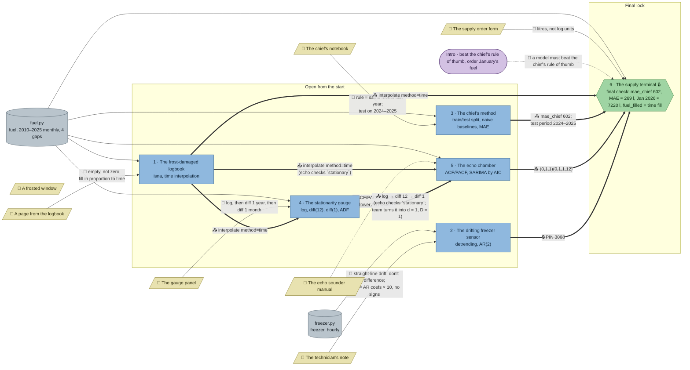

# Station Nordlys: flow

What a team has to carry from where to where in `ts-nordlys`. Hand-maintained with the `room-flow` skill; update it when the room's puzzles, clues, reveals or locks change. Values and solutions: [the walkthrough](../walkthroughs/ts-nordlys.en.md).

| Arrow | Meaning |
|---|---|
| `==>` thick | A result, lock code or final digit moves from one station to another |
| `-->` solid | A clue or data file the station can't be solved without |
| `-.->` dotted | Context only: the value is also in the task text or starter code, or it only helps to judge a result that isn't checked |

The room has no `requires` any more. The supply terminal is the `final` Python check and sits behind a code `lock` (PIN 3068 from the freezer's reveal). Its grader `_supply_check(mae_chief, mae_sarima, jan_2026, fuel_filled)` in `fuel.py` wants the chief's 602 without stating it, accepts only the airline model's numbers (holdout MAE within 10 l of 269, January within 15 l of 7220) and a `fuel_filled` that matches `interpolate(method="time")` within 0.5 l (a linear fill passes the model numbers but not this). The frosted window (aurora) is flavour and feeds no station.

## Phases

- **Start:** 5 stations open (logbook, freezer, chief's method, gauge, echo chamber). Logbook, freezer and chief's method need nothing from elsewhere; the gauge needs the logbook's fill, the echo chamber the gauge's transform, so those two teams find out they have to wait or ask.
- **Final:** the supply terminal opens with the freezer's PIN, and its check needs the chief's 602 and test period, the echo chamber's model and the logbook's fill.
- Parallel width: 3 stations solvable at once from the start (logbook, freezer, chief), 5 open; enough for a team of 3–5.

## Chains

- Logbook → gauge → echo chamber → supply terminal: 4 stations, the longest path.
- Chief's method → supply terminal; freezer → supply terminal: 2 stations each.

## Hand-offs

- Between stations: 7 edges, all hard (logbook → gauge, logbook → echo, logbook → supply, gauge → echo, chief → supply, echo → supply, freezer PIN → supply lock).
- From clues: 7 clues; 5 hard (logbook page, technician's note, chief's notebook, gauge panel, order form), 1 soft (echo manual), 1 flavour (frosted window).

## Where things are

Tiles are 32 px; the map is 30 × 20 tiles: a boot room at the airlock (west), an ops corridor across the middle, three rooms north of it (generator room, mess, chief's office) and three south (lab, instrument room, supply depot).

- Next to their station (1 tile): the logbook page, the chief's notebook, the gauge panel.
- In the same room: the technician's note hangs on the lab wall about 5 tiles east of the freezer, the echo manual on the instrument room wall about 5 tiles east of the echo sounder.
- A walk away: the order form hangs on the ops corridor wall, about 12 tiles from the supply terminal in the supply depot (south-east).
- The logbook and the gauge share the generator room (north-west); the other hand-offs cross the station: gauge → echo chamber (instrument room, south centre), chief (office, north-east) and echo → supply (depot, south-east), so they need walking and talking.

## Findings

Fixed in the shortcut review:

- **The final no longer accepts any fill.** A linear `interpolate()` passed the model numbers (MAE 270 vs 269, January 7220), so the logbook's time interpolation was not needed for the escape. `_supply_check` now also takes `fuel_filled` and wants it within 0.5 l of the time fill (ffill, bfill, linear, mean and unfilled all fail).
- **The echo chamber's check now includes `stationary`** (length and standard deviation, as the gauge checks it). Before, only the orders were checked, and a team that guessed d = D = 1 skipped the gauge and the log step (the AIC winner is the same on a linear fill, an unfilled log and even on levels). Now it needs the logbook's fill and the gauge's log → diff(12) → diff(1).
- **The PIN is 3068, not 4711** (a well-known stand-in PIN a team could try at the order form).
- Tested and fine: a wrong test period (2025 only, 2024 only) fails the chief; no log, log + diff(12) only, log + diff(1) only, linear or forward fill fail the gauge; d or D = 0 makes the AIC pick another model; for the freezer, raw AR(2) gives 91 and the differenced and demeaned variants fail (`trend="ct"` also gives 63, the same reasoning as detrending); models next to the airline model, an unfilled or forward-filled log, levels instead of log and a guessed 600 for the chief are rejected by the supply grader.

Left as it is:

- **A team that knows the airline model can skip the echo chamber's reasoning for the final.** `SARIMAX(order=(0,1,1), seasonal_order=(0,1,1,12))` on the time-filled log passes the supply check (it still needs the logbook's fill, the chief's 602 and the freezer's PIN). The airline model is the textbook default for monthly data, so only a team that already knows it gets here. A bigger fix would regenerate the fuel data so the true model is not the airline one (for example (1,1,1)(0,1,1,12), whose January differs by 25 l from the airline's) with tighter tolerances, which also changes the 602, the hints and the ACF/PACF reading.

Fixed in the second review (every clue once, no pointers to clues or other stations outside the hints, a clear goal per station):

- **No task, starter or check message names a clue or another station.** Gone: "the way the logbook page describes", "the technician's note explains how to read it", "named in the chief's notebook", "as the gauge panel describes", "repair them as the logbook station does", "the series that turned the gauge green", "the differencing the gauge needed", "the winner from the echo chamber", "as the order form asks", and the supply check's "Ask at the chief's desk", "the echo chamber's winner" and "Read the order form". Each station's hint 1 now says where to look.
- **Reveals no longer route the team.** The logbook's "every station needs it repaired this way", the chief's "the supply terminal will ask for 602 … 2024–2025" (the test period now lives only in the notebook), and the echo chamber's "the supply terminal only accepts this model" are gone. The gauge's reveal no longer works out d = 1 and D = 1 for the echo chamber; the echo team derives them from log → diff(12) → diff(1) (hint 1 explains how).
- **Each rule lives once.** "Green below p = 0.05" is only in the gauge's task (the panel no longer repeats it); "beat the chief on her test period and state her error" is only in the supply task (the order form keeps only "litres, not log units").
- **The starters no longer solve part of the task.** The freezer's starter no longer says "remove the drift, fit an AR(2), `sm.tsa.ARIMA(..., order=(2, 0, 0))`" (that is the technician's note, plus the fit call in hint 2 and the handbook); the echo chamber's starter no longer contains the `SARIMAX` call (now in hint 2 and the handbook).
- **Goals up front:** the chief's method asks "How far off are two of them?", the gauge "Which transformations make the fuel log stationary?", the echo chamber "Which of the candidate models fits best?". Every station already ended in a checked value or code, so no booleans were added.

Fixed in the first review:

- `requires` everywhere → gone. The gauge, echo and supply starters no longer contain `interpolate(method="time")` or the log/diff transform; the gauge's check fails with any other fill (linear changes the std, dropping gaps changes the length), the echo candidates come as (p, q)(P, Q) and need d = D = 1 from the gauge (with d = D = 0 the AIC picks (1,0,0)(1,0,0,12)), and the supply check rejects an unfilled or forward-filled log.
- The echo chamber's result is now needed: the supply check accepts only the airline model; the next-best candidates miss by 25 l on January ((1,1,1)(0,1,1,12)) or 23 l on the MAE ((2,1,0)(0,1,1,12)).
- Freezer → supply is a code lock (PIN 3068); the `pin` variable is gone.
- The check's messages no longer state 602 or hint at the log scale; the team brings `mae_chief` from the chief's station.
- Soft clues: the chief's notebook is now the only source of the rule and the test period (task, starter and supply text no longer give them); the order form is the only place that asks for litres instead of log units.
- 5 stations open from the start instead of 2.

Left as they are:

- **The echo manual stays soft.** Hint 1 points to it, but "lower AIC wins" is common knowledge and the ACF/PACF reading isn't checked. Checking the reading would add a task; not worth the time budget.
- **The frosted window feeds nothing.** The season length 12 would be its natural value, but every student knows monthly data repeats every 12 months, so it couldn't be a hard clue.
- **Small leaks of the test period:** the echo starter trains on `log_fuel[:"2023-12"]`, so a team reading the echo chamber's code can guess the chief's test period without the notebook. The echo chamber needs a fixed training window for its AIC comparison.
- **The order form's "litres, not log" is partly common sense**: the supply starter asks for the MAE "against the real litres", which already implies `np.exp`.
