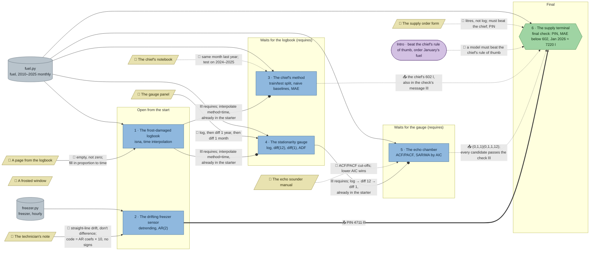

# Station Nordlys: flow

What a team has to carry from where to where in `ts-nordlys`. Hand-maintained with the `room-flow` skill; update it when the room's puzzles, clues, reveals or locks change. Values and solutions: [the walkthrough](../walkthroughs/ts-nordlys.en.md).

| Arrow | Meaning |
|---|---|
| `==>` thick | A result, lock code or final digit moves from one station to another |
| `-->` solid | A clue or data file the station can't be solved without |
| `-.->` dotted | Context only: the value is also in the task text or starter code, or it only helps to judge a result that isn't checked |
| `--o` ⛓ | A `requires` lock: the station stays closed until the other is solved, but no knowledge moves |
| ⛓ at the end of a label | The target also `requires` the source |

This room has no `lock` codes and no final digits: the supply terminal is a `final` Python check, and every station after the first two is gated by `requires`. The frosted window (aurora) is flavour and feeds no station.

## Phases

- **Start:** 2 stations open (logbook, freezer). Enough for a pair; in a team of 3–5 the rest watch or share a screen.
- **Second wave:** the chief's method and the gauge open together once the logbook is solved: again 2 stations in parallel (the freezer may still be running).
- **Third wave:** the echo chamber opens after the gauge, alone.
- **Final:** the supply terminal opens once the freezer, the chief's method and the echo chamber are all solved.
- Peak parallel width: 2 stations (3 if the freezer is still open when the second wave starts).

## Chains

- Logbook → gauge → echo chamber → supply terminal: 4 stations, the longest path.
- Logbook → chief's method → supply terminal: 3 stations.
- Freezer → supply terminal: 2 stations, the only chain with a hard hand-off.

## Hand-offs

- Between stations: 6 `requires` edges, but only 1 piece of knowledge that the check can't pass without (the PIN 4711 from the freezer's reveal). The other 5 carry nothing the next station needs: the starters already contain the logbook's interpolation and the gauge's transform, and the supply check accepts every echo candidate and states the 602 itself.
- From clues: 7 clues; 3 hard (logbook page, technician's note, gauge panel), 3 soft (chief's notebook, echo manual, order form), 1 flavour (frosted window).

## Where things are

Tiles are 32 px; the map is 22 × 15 tiles.

- Next to their station (1 tile): the logbook page, the chief's notebook, the gauge panel.
- A short walk: the technician's note stands about 6 tiles from the freezer (north-west of it), the echo manual about 7 tiles from the echo chamber (north-east).
- Across the room: the order form hangs on the north wall by the exit, about 10 tiles from the supply terminal in the south-east.

## Findings

- **Only one hard hand-off between stations.** Of the six `requires`, only freezer → supply carries knowledge the check needs (the PIN). The others are pure waiting: the chief, gauge, echo and supply starters all contain `fuel.interpolate(method="time")`, and the echo starter contains `log_fuel.diff(12).diff(1)`.
- **The echo chamber's result isn't needed.** The supply check accepts all five echo candidates (holdout MAE 268–595 l, January forecast 7176–7245 l, all within 3 % of 7220 and below 602). Narrowing the check (for example a tighter tolerance on `jan_2026`, or checking `mae_sarima` against the airline model's ≈ 269) or leaving `order` out of the starter as a must-know would make echo → supply a hard `uses`.
- **`requires` that could become `uses` or a code lock:** freezer → supply is already a natural code lock (`lock.from: freezer`, PIN 4711 typed at the terminal instead of a `pin` variable). logbook → chief / gauge could become `uses` if those starters loaded the gappy `fuel` without the interpolation line, so the team has to bring `method="time"` from the logbook. gauge → echo could become `uses` if the echo starter left the transform out. chief → supply could become `uses` if the supply check's message didn't state 602 and the team had to bring `mae_snaive`.
- **Soft clues:** the chief's notebook (the task text already defines seasonal naive and the 2024–2025 test period), the echo manual (the AIC loop alone finds the winner; the ACF/PACF reading isn't checked) and the order form (task and starter already say litres, back-transform, beat the chief and PIN).
- **Only 2 stations open from the start**, against the rooms.md rule of several open stations for a team of 3–5; the logbook gates 4 of the other 5 stations. Since the logbook's result isn't actually needed downstream, dropping `requires: ["logbook"]` from the chief and the gauge would open 4 stations at once.
- **The frosted window feeds nothing.** Fine as flavour, but it could carry a hard value (for example the seasonal period 12 for the gauge or echo) to earn its place.
